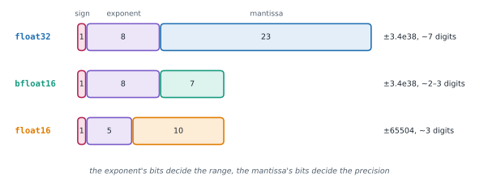

# Lesson 3: Data types and precision

**You'll learn:** the common dtypes and their aliases, bytes per element, the default dtype, when printing shows dtype=, converting with .to and shortcut methods, truncation versus rounding, type promotion categories, Python scalars and 0-D tensors in promotion, true division, in-place dtype errors, float32 versus float16 versus bfloat16 (range and precision), finfo and iinfo, comparing floats.

▶ **Practise this lesson in the [sandbox](https://kishoremadanagopal.github.io/learning/pytorch/#dtypes)**: run every example and check your exercise answers.

## Key terms

- **Default dtype:** the floating-point type PyTorch uses when you don't choose one: float32 (`torch.get_default_dtype()`).
- **float32 (torch.float):** 32-bit floating point, the standard type for model weights.
- **float16 (torch.half):** 16-bit floating point with 5 exponent bits: precise but a small range (max 65504).
- **bfloat16:** 16-bit "brain" floating point with float32's 8 exponent bits: float32's range, less precision.
- **int64 (torch.long):** 64-bit integers, PyTorch's default for whole numbers, class labels and indexes.
- **Type promotion:** the rules PyTorch uses to choose the dtype of a result from inputs of different dtypes.
- **Exponent and mantissa:** the parts of a floating-point number that set its range and its precision.
- **Overflow:** a value too large for its dtype, becoming `inf` for floats or wrapping around for integers.
- **finfo / iinfo:** objects describing a float or integer dtype's limits, such as `max` and `eps`.
- **allclose:** checks that two tensors are equal within a tolerance.

Every tensor has one **dtype** for all its elements. It decides what values fit, how precise they are and how much memory they take.

| dtype | Aliases | Bytes | Used for |
|---|---|---|---|
| `torch.float32` | `torch.float` | 4 | the default for model weights and inputs |
| `torch.float64` | `torch.double` | 8 | scientific code; NumPy's default float |
| `torch.float16` | `torch.half` | 2 | mixed-precision training and inference on GPUs |
| `torch.bfloat16` | | 2 | mixed precision on newer GPUs and TPUs; same range as float32 |
| `torch.int64` | `torch.long` | 8 | class labels, indexes, counts |
| `torch.int32` | `torch.int` | 4 | smaller integers |
| `torch.uint8` | | 1 | raw image pixels (0–255) |
| `torch.bool` | | 1 | masks: results of comparisons |

```python
import torch

print(torch.float is torch.float32, torch.long is torch.int64)
print(torch.get_default_dtype())
x = torch.zeros(1000)
print(x.dtype, x.element_size(), x.nbytes)               # 4 bytes per float32
print(torch.zeros(1000, dtype=torch.float16).nbytes)     # half the memory
```

## How printing shows the dtype

A tensor's printout adds `dtype=` only when the dtype isn't one PyTorch would infer anyway: float32 (the default), int64 and bool are left out.

```python
import torch

print(torch.tensor([1.0, 2.0]))
print(torch.tensor([1.0, 2.0], dtype=torch.float64))
print(torch.tensor([1, 2]))
print(torch.tensor([1, 2], dtype=torch.int32))
print(torch.tensor([1.0, 2.0], dtype=torch.bfloat16))
```

## Converting

`.to(dtype)` returns a converted copy (or the same tensor if nothing changes). The short methods `.float()`, `.double()`, `.half()`, `.bfloat16()`, `.long()`, `.int()` and `.bool()` do the same. Converting float to int **truncates toward zero**; it doesn't round.

```python
import torch

x = torch.tensor([1.7, -1.7, 2.5])
print(x.long())                  # truncates toward zero
print(x.round())                 # rounds half to even: 2.5 -> 2
print(x.to(torch.int32))
print(torch.tensor([0, 3, 0]).bool())
print(torch.tensor([300]).to(torch.uint8))   # wraps around: 300 - 256
```

## Type promotion: the dtype of a result

When an operation mixes dtypes, PyTorch picks the result's dtype in **categories**: bool < integer < floating point < complex.

1. A tensor with dimensions decides within its category, but a higher category wins: int64 tensor + float32 tensor is float32.
2. A **Python number** or a **0-dimensional tensor** can raise the category but never the size. int tensor + `1.5` gives the **default float** (float32), not float64; a float16 tensor + `1.0` stays float16.
3. **True division** `/` always gives a float, even for two ints. `//` keeps ints.

```python
import torch

ints = torch.tensor([1, 2, 3])
print((ints + 1).dtype)                   # stays int64
print((ints + 1.5).dtype)                 # float category: default float32
print((ints / 2))                         # / always gives floats
print((ints // 2))                        # floor division keeps int64
half = torch.tensor([1.0, 2.0], dtype=torch.float16)
print((half + 1.0).dtype)                 # a Python float doesn't upcast
print((half + torch.tensor([1.0, 2.0])).dtype)   # a float32 tensor does
print(torch.promote_types(torch.int32, torch.float16))
```

In-place operations (`+=`, `.add_()`) can't change a tensor's dtype, so adding a float to an int tensor in place is an error:

*This example raises an error on purpose.*

```python
import torch

counts = torch.tensor([1, 2, 3])
counts += 0.5
```

## Precision and range: float32, float16 and bfloat16

A floating-point number stores a sign, an **exponent** (which sets the **range**: how big or small a value can be) and a **mantissa** (which sets the **precision**: how many significant digits).



- **float16** keeps more precision than bfloat16 but has a tiny range: anything over 65504 becomes `inf`, and very small gradients underflow to 0. Training in float16 needs **loss scaling** (Part 5).
- **bfloat16** ("brain float") keeps float32's 8 exponent bits, so it has the same range and rarely overflows, at the cost of precision. It's the usual choice for mixed-precision training on modern GPUs.
- Both halve memory and speed up maths on GPUs with tensor cores, which is why Part 5 uses them.

```python
import torch

third = torch.tensor(1 / 3)
print(third.item())
print(third.half().item())
print(third.bfloat16().item())
print(torch.tensor([70000.0]).half())      # past float16's maximum
print(torch.tensor([70000.0]).bfloat16())  # bfloat16 has the range, less precision
print(torch.finfo(torch.float16).max, torch.finfo(torch.bfloat16).max)
```

`torch.finfo(dtype)` tells you a float type's limits (`max`, `eps`, `tiny`), and `torch.iinfo(dtype)` an integer type's.

## Float comparisons

Floating-point maths rounds, so test closeness, not equality: `torch.allclose(a, b)` (one True/False for the whole tensor) or `torch.isclose(a, b)` (element by element). `torch.equal(a, b)` is exact: same shape and same values.

```python
import torch

a = torch.tensor([0.1 + 0.2])
b = torch.tensor([0.3])
print(a == b)
print(torch.allclose(a, b))
print(torch.equal(torch.tensor([1, 2]), torch.tensor([1, 2])))
```

## At a glance

| Concept | Code | Gives you | Remember |
|---|---|---|---|
| Choose a dtype | `dtype=torch.float32` at creation | predictable maths and memory | float32 for models, int64 for labels |
| Convert | `.to(torch.float16)`, `.float()`, `.long()` | a converted copy | float → int truncates toward zero |
| Promotion | bool < int < float < complex | the result's dtype | Python numbers raise the category, never the size |
| Division | `/` vs `//` | floats vs floor-divided ints | `/` on ints gives float32 |
| 16-bit floats | `float16` vs `bfloat16` | half the memory | bfloat16 keeps float32's range |
| Limits | `torch.finfo(dtype).max`, `.eps` | range and precision | float16 max 65504 |
| Compare floats | `torch.allclose(a, b)` | equal within tolerance | `torch.equal` is exact |

## Common mistakes

- Expecting `.long()` or `.int()` to round; they truncate toward zero.
- Expecting `int_tensor + 1.5` to be float64; Python numbers give the default float32.
- Expecting `/` on integer tensors to give integers; use `//` for floor division.
- Doing in-place float maths on an integer tensor (`x += 0.5`), which raises an error.
- Using float16 for values above 65504, which overflow to `inf`.
- Comparing floats with `==` instead of `torch.allclose` or `torch.isclose`.

## Exercises

### 1. Prepare pixels for a model

`pixels` is a uint8 tensor of raw image values (0–255). Make `scaled`: the same values as float32 between 0 and 1 (divide by 255). Then make `as_half`: `scaled` converted to float16, and `saved_bytes`: how many bytes `as_half` saves compared with `scaled` (a Python int).

Starter code:

```python
import torch

pixels = torch.tensor([[0, 64, 128], [192, 255, 32]], dtype=torch.uint8)
scaled = None
as_half = None
saved_bytes = None
print(scaled, as_half, saved_bytes, sep="\n")
```

<details>
<summary>🧭 How to approach it</summary>

1. **Understand:** convert dtype, scale, convert again, and measure memory.
2. **Examples:** 255 → 1.0, 128 → 0.502.
3. **Brute force:** compute bytes as 6 × 4 − 6 × 2 by hand; better to ask the tensors.
4. **Pattern:** **explicit conversion** before arithmetic, and **nbytes** for memory.
5. **Plan:** `pixels.float() / 255`; `.half()`; subtract nbytes.
6. **Code and test:** print dtypes and the saving.

</details>

<details>
<summary>💡 Hint 1</summary>

`/` already gives floats, but convert explicitly with `.float()` so the result is float32 whatever the input.

</details>

<details>
<summary>💡 Hint 2</summary>

`.half()` (or `.to(torch.float16)`) converts to float16.

</details>

<details>
<summary>💡 Hint 3</summary>

`.nbytes` is `numel() × element_size()`: 6 × 4 for float32, 6 × 2 for float16.

</details>

### 2. Predict the dtype

Fill in `answers`, a dict mapping each expression (as written in the starter) to the dtype you expect, like `torch.float32`. Predict first, then run the expressions to check yourself.

Starter code:

```python
import torch

i64 = torch.tensor([1, 2])
f32 = torch.tensor([1.0, 2.0])
f16 = torch.tensor([1.0, 2.0], dtype=torch.float16)
answers = {
    "i64 + 1": None,
    "i64 / 1": None,
    "i64 * 2.0": None,
    "f16 * 2.0": None,
    "f16 + f32": None,
    "i64 > 1": None,
    "f32.sum()": None,
    "i64.sum()": None,
}
```

<details>
<summary>🧭 How to approach it</summary>

1. **Understand:** apply the promotion rules: category first, then size, with Python numbers counting only for category.
2. **Examples:** `torch.tensor([1]) + 1.5` → float32.
3. **Brute force:** run each one: fine for checking, but the exam won't let you.
4. **Pattern:** **category rule**: bool < int < float < complex; tensors with dims decide the size.
5. **Plan:** go line by line and write the dtype.
6. **Code and test:** press Check; a wrong answer names the expression.

</details>

<details>
<summary>💡 Hint 1</summary>

Comparisons always return `torch.bool`.

</details>

<details>
<summary>💡 Hint 2</summary>

A Python number can move the result up a category (int → float) but uses the *default* size for it, and never makes a float16 tensor bigger.

</details>

<details>
<summary>💡 Hint 3</summary>

`/` is true division and always returns a floating-point dtype.

</details>

**In the sandbox:** exercises 5–6. Press **Check** to run the hidden tests.

### Answers and walkthroughs

Open these only after a real attempt. Each one explains the solution step by step.

<details>
<summary>✅ 1. Prepare pixels for a model</summary>

```python
import torch

pixels = torch.tensor([[0, 64, 128], [192, 255, 32]], dtype=torch.uint8)
scaled = pixels.float() / 255
as_half = scaled.half()
saved_bytes = scaled.nbytes - as_half.nbytes
print(scaled, as_half, saved_bytes, sep="\n")
```

**Line by line**

- `pixels.float()` converts uint8 to float32 so the division keeps fractions; dividing by 255 maps 0–255 to 0–1. (This is what torchvision's `ToDtype(torch.float32, scale=True)` does, Part 3.)
- `scaled.half()` rounds every value to float16's 10-bit mantissa: 64/255 = 0.25098 becomes 0.25098 ≈ 0.2510 (close, not identical).
- `scaled.nbytes` is 24 and `as_half.nbytes` is 12, so `saved_bytes` is 12: half the memory, which is why large models are stored in 16-bit types.

**Common wrong approach:** dividing a uint8 tensor with `//`, which gives integers 0 or 1.

</details>

<details>
<summary>✅ 2. Predict the dtype</summary>

```python
import torch

answers = {
    "i64 + 1": torch.int64,       # int with an int: no change
    "i64 / 1": torch.float32,     # true division always gives a float (the default float)
    "i64 * 2.0": torch.float32,   # a Python float lifts the category to float, at the default size
    "f16 * 2.0": torch.float16,   # same category: a Python number never upcasts
    "f16 + f32": torch.float32,   # two tensors with dims: the bigger float wins
    "i64 > 1": torch.bool,        # comparisons give bool
    "f32.sum()": torch.float32,
    "i64.sum()": torch.int64,     # integer sums are int64
}
```

**The rules applied**

| Expression | Why |
|---|---|
| `i64 + 1` | both integers; the tensor's int64 decides |
| `i64 / 1` | `/` promotes integers to the default float, float32 |
| `i64 * 2.0` | a Python float raises the category to float, using the default float32 (not float64) |
| `f16 * 2.0` | already float; a Python number doesn't change the size |
| `f16 + f32` | two tensors with dimensions: float16 and float32 promote to float32 |
| `i64 > 1` | comparison: bool |
| `f32.sum()` | sums keep floating dtypes |
| `i64.sum()` | integer (and bool) sums are int64 |

**Common wrong approach:** expecting `i64 * 2.0` to be float64 because a Python float is a 64-bit double. PyTorch deliberately uses the default dtype so that Python numbers don't silently double your memory.

</details>

## Quick quiz

1. What is the dtype of `torch.tensor([1, 2]) / torch.tensor([2, 2])`?
   - A) `torch.float32`
   - B) `torch.int64`
   - C) `torch.float64`
   - D) `torch.int32`

2. Why is bfloat16 often preferred over float16 for training?
   - A) It has the same exponent range as float32, so values rarely overflow or underflow
   - B) It is more precise than float16
   - C) It uses less memory than float16
   - D) It is the only 16-bit type GPUs support

3. `x = torch.tensor([2.9, -2.9])`. What does `x.long()` return?
   - A) `tensor([ 2, -2])`
   - B) `tensor([ 3, -3])`
   - C) `tensor([ 2, -3])`
   - D) `tensor([ 3, -2])`

4. `h = torch.ones(3, dtype=torch.float16)`. What is `(h * 3.0).dtype`?
   - A) `torch.float16`
   - B) `torch.float32`
   - C) `torch.float64`
   - D) `torch.int64`

5. Which check is the right way to compare two float tensors computed in different ways?
   - A) `torch.allclose(a, b)`
   - B) `torch.equal(a, b)`
   - C) `a == b`
   - D) `a is b`

<details>
<summary>Quiz answers</summary>

1. **A) `torch.float32`**: True division always returns a floating-point result; for integer inputs that's the default dtype, float32.
2. **A) It has the same exponent range as float32, so values rarely overflow or underflow**: bfloat16 trades mantissa bits (precision) for float32's 8 exponent bits (range). Both use 2 bytes.
3. **A) `tensor([ 2, -2])`**: Converting to an integer dtype truncates toward zero.
4. **A) `torch.float16`**: A Python scalar can only raise the category (int → float), never the size within a category.
5. **A) `torch.allclose(a, b)`**: Rounding makes exact float equality unreliable; allclose compares within a tolerance (rtol=1e-05, atol=1e-08 by default).

</details>

---
Previous: [Lesson 2](02-creating-tensors.md) · Next: [Lesson 4: Indexing, slicing and views](04-indexing-and-views.md)
