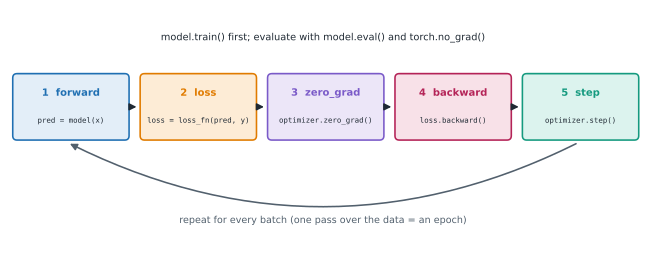
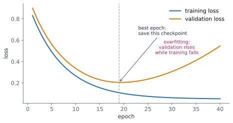

# Lesson 12: The training and evaluation loop

**You'll learn:** training, validation and test sets, generalisation and overfitting, epochs and shuffled mini-batches, a complete classification training loop, model.train() and model.eval(), dropout and batch norm in each mode, evaluating under torch.no_grad, accuracy from argmax, reading training and validation curves, underfitting, early stopping and keeping the best weights with deepcopy, training on a GPU.

▶ **Practise this lesson in the [sandbox](https://kishoremadanagopal.github.io/learning/pytorch/#training-loop)**: run every example and check your exercise answers.

## Key terms

- **Training set:** the data the optimizer learns from.
- **Validation set:** held-out data for measuring generalisation and choosing settings during development.
- **Test set:** data used once at the end for an unbiased final score.
- **Generalisation:** how well a model performs on data it wasn't trained on.
- **Overfitting:** fitting the training data so closely that performance on new data gets worse.
- **Underfitting:** a model too simple, or trained too little, to fit even the training data.
- **model.train() / model.eval():** switch layers such as dropout and batch norm between training and evaluation behaviour.
- **Dropout:** randomly zeroing activations during training to reduce overfitting.
- **Batch normalisation:** normalising activations with batch statistics in training and running averages in evaluation.
- **Early stopping:** keeping the weights from the epoch with the best validation score.
- **Accuracy:** the fraction of samples whose predicted class matches the label.

A full training run repeats the training step over **mini-batches** for several **epochs**, and regularly checks the model on data it doesn't train on.



## Training, validation and test data

- The **training set** is what the optimizer learns from.
- The **validation set** is held out to measure how well the model **generalises** while you choose settings (learning rate, epochs, model size).
- A **test set**, used once at the very end, gives an unbiased final score.

A model that does much better on training data than on validation data has **overfitted**: it memorised the training examples instead of learning the pattern.

## A complete loop

The data: points from two overlapping clouds, labelled 0 and 1, plus a third class.

```python
import torch
from torch import nn, optim

torch.manual_seed(0)
n = 600
centers = torch.tensor([[0.0, 0.0], [2.0, 2.0], [0.0, 2.5]])
y_all = torch.randint(0, 3, (n,))
x_all = centers[y_all] + torch.randn(n, 2)            # each point near its class centre

perm = torch.randperm(n)                              # shuffle before splitting
train_idx, val_idx = perm[:480], perm[480:]
x_train, y_train = x_all[train_idx], y_all[train_idx]
x_val, y_val = x_all[val_idx], y_all[val_idx]

model = nn.Sequential(nn.Linear(2, 32), nn.ReLU(), nn.Linear(32, 3))
loss_fn = nn.CrossEntropyLoss()
opt = optim.Adam(model.parameters(), lr=0.01)
batch_size = 32

def evaluate(x, y):
    model.eval()
    with torch.no_grad():
        logits = model(x)
        loss = loss_fn(logits, y).item()
        acc = (logits.argmax(dim=1) == y).float().mean().item()
    return loss, acc

for epoch in range(1, 11):
    model.train()
    order = torch.randperm(len(x_train))              # a new order every epoch
    for i in range(0, len(x_train), batch_size):
        idx = order[i:i + batch_size]
        xb, yb = x_train[idx], y_train[idx]
        loss = loss_fn(model(xb), yb)
        opt.zero_grad()
        loss.backward()
        opt.step()
    if epoch in (1, 2, 5, 10):
        tl, ta = evaluate(x_train, y_train)
        vl, va = evaluate(x_val, y_val)
        print(f"epoch {epoch:2d}  train loss {tl:.3f} acc {ta:.2f}  |  val loss {vl:.3f} acc {va:.2f}")
```

Key details:

- **Shuffle every epoch** (`torch.randperm`), so batches differ each time and the model can't learn the order.
- The last batch may be smaller (480 / 32 is exact here, but often it isn't); that's fine.
- `evaluate` switches to **eval mode** and **no_grad**, and the loop switches back with `model.train()` at the start of every epoch.
- Accuracy is `argmax` of the logits compared with the labels.

## model.train() and model.eval()

Some layers behave differently while training:

| Layer | `model.train()` | `model.eval()` |
|---|---|---|
| `nn.Dropout(p)` | zeroes a random fraction p of values, scales the rest by 1/(1 − p) | does nothing |
| `nn.BatchNorm1d/2d` | normalises with the batch's statistics and updates running averages | uses the stored running averages |
| everything else (Linear, ReLU…) | same | same |

`model.eval()` sets the `training` flag on the model and every submodule; `model.train()` sets it back. **Neither affects autograd**: eval mode still records graphs unless you also use `torch.no_grad()` (or `inference_mode()`). Forgetting `eval()` gives random predictions (dropout) or predictions that depend on the rest of the batch (batch norm); forgetting `no_grad` wastes memory and time.

```python
import torch
from torch import nn

torch.manual_seed(0)
drop = nn.Dropout(p=0.5)
x = torch.ones(8)
print(drop.training, drop(x))         # training: about half zeroed, the rest doubled
drop.eval()
print(drop.training, drop(x))         # eval: unchanged

bn = nn.BatchNorm1d(2)
batch = torch.tensor([[1.0, 10.0], [2.0, 25.0], [6.0, 55.0]])
print(bn(batch))                      # training: normalised with this batch's mean and variance
print(bn.running_mean)                # moved 10% towards the batch mean
bn.eval()
print(bn(torch.tensor([[3.0, 30.0]])))   # eval: uses the running averages
```

(The dropout pattern in this sandbox differs from real PyTorch's: PyTorch's CPU dropout uses a different random-number routine. Which elements are dropped is random either way.)

## Reading the curves



| What you see | Likely meaning | Try |
|---|---|---|
| both losses high and flat | **underfitting**, or the learning rate is too low | a bigger model, more epochs, a higher lr |
| training falls, validation rises | **overfitting** | more data, weight decay, dropout, fewer epochs (early stopping) |
| loss jumps to `nan` or explodes | the learning rate is too high, or bad data | lower lr, gradient clipping, check inputs |
| training loss noisy but falling | normal with mini-batches | nothing |

**Early stopping:** keep the weights from the epoch with the best validation score. A model's `state_dict()` shares memory with its parameters, so save a **copy** (`copy.deepcopy`), not the live dict (lesson 6).

## On a GPU

The loop is identical on a GPU; only two things move: the model (once, before creating the optimizer) and each batch.

```python
import torch
from torch import nn, optim

device = "cuda" if torch.cuda.is_available() else "cpu"
torch.manual_seed(0)
x = torch.randn(256, 4)
y = (x.sum(dim=1) > 0).long()

model = nn.Sequential(nn.Linear(4, 16), nn.ReLU(), nn.Linear(16, 2)).to(device)
opt = optim.SGD(model.parameters(), lr=0.5)
for epoch in range(20):
    for i in range(0, 256, 64):
        xb, yb = x[i:i + 64].to(device), y[i:i + 64].to(device)   # move each batch
        loss = nn.functional.cross_entropy(model(xb), yb)
        opt.zero_grad()
        loss.backward()
        opt.step()
model.eval()
with torch.no_grad():
    acc = (model(x.to(device)).argmax(1) == y.to(device)).float().mean()
print(device, f"accuracy {acc.item():.2f}")
```

## At a glance

| Concept | Code | Gives you | Remember |
|---|---|---|---|
| Split data | `perm = torch.randperm(n)`; slice train / val | honest validation | shuffle before splitting |
| Epoch loop | `for epoch …: model.train(); for batch …: step` | many updates | reshuffle each epoch |
| Evaluate | `model.eval()` + `with torch.no_grad():` | deterministic, cheap metrics | then `model.train()` again |
| Accuracy | `(logits.argmax(1) == y).float().mean()` | fraction correct | bools must be cast to float |
| Dropout / BatchNorm | behave differently in train and eval | regularisation, normalisation | BatchNorm needs batches > 1 in training |
| Early stopping | `best = copy.deepcopy(model.state_dict())` | the best epoch's weights | state_dict shares memory |
| On a GPU | `model.to(device)` once; `xb.to(device)` per batch | the same loop, faster | move the model before the optimizer |

## Common mistakes

- Evaluating without `model.eval()`, so dropout and batch norm behave as in training.
- Thinking `model.eval()` turns off gradient tracking; use `torch.no_grad()` as well.
- Forgetting `model.train()` after evaluating in the middle of training.
- Not shuffling the training data each epoch.
- Keeping `model.state_dict()` as the "best" weights without copying it.
- Tuning settings on the test set instead of the validation set.

## Exercises

### 1. Evaluate a model

Write `evaluate(model, x, y, loss_fn)` that returns `(mean_loss, accuracy)` as Python floats for a classification model, computed in **eval mode** without recording a graph. It must leave the model in the mode it was in before (so it can be called in the middle of training).

Starter code:

```python
import torch
from torch import nn

def evaluate(model, x, y, loss_fn):
    pass

torch.manual_seed(0)
model = nn.Sequential(nn.Linear(3, 8), nn.Dropout(0.5), nn.ReLU(), nn.Linear(8, 2))
x = torch.randn(20, 3)
y = torch.randint(0, 2, (20,))
print(evaluate(model, x, y, nn.CrossEntropyLoss()))
print(model.training)
```

<details>
<summary>🧭 How to approach it</summary>

1. **Understand:** an evaluation helper that's safe to call during training.
2. **Examples:** called on a model in training mode, it returns with the model still in training mode.
3. **Brute force:** always calling `model.train()` at the end breaks callers that were in eval mode.
4. **Pattern:** **save state → change → restore**.
5. **Plan:** store `model.training`, eval + no_grad, compute, restore.
6. **Code and test:** the dropout layer would make results random if eval() were missing.

</details>

<details>
<summary>💡 Hint 1</summary>

Remember the mode first: `was_training = model.training`.

</details>

<details>
<summary>💡 Hint 2</summary>

`model.eval()`, then compute inside `with torch.no_grad():`.

</details>

<details>
<summary>💡 Hint 3</summary>

Restore with `model.train(was_training)` (train(False) is the same as eval()).

</details>

### 2. Train with early stopping

Write `fit(model, train, val, epochs, lr)` where `train` and `val` are `(x, y)` pairs for classification. Each epoch: train on the full training batch once (Adam, cross-entropy), then compute the validation loss in eval mode without grad. Keep a **copy** of the `state_dict` with the lowest validation loss, load it back into the model at the end, and return the best epoch number (1-based).

Starter code:

```python
import copy
import torch
from torch import nn, optim

def fit(model, train, val, epochs, lr):
    pass

torch.manual_seed(0)
x = torch.randn(60, 5); y = (x[:, 0] > 0).long()
model = nn.Sequential(nn.Linear(5, 64), nn.ReLU(), nn.Linear(64, 2))
best = fit(model, (x[:20], y[:20]), (x[20:], y[20:]), epochs=60, lr=0.05)
print("best epoch:", best)
```

<details>
<summary>🧭 How to approach it</summary>

1. **Understand:** train, validate each epoch, remember the best weights, restore them.
2. **Examples:** with only 20 training points and a big hidden layer, validation loss bottoms out and then rises.
3. **Brute force:** save every epoch's weights and pick at the end: works, but wastes memory.
4. **Pattern:** **early stopping with the best checkpoint**.
5. **Plan:** optimizer, loop, validate, deepcopy on improvement, load at the end.
6. **Code and test:** check the returned weights equal the best epoch's.

</details>

<details>
<summary>💡 Hint 1</summary>

Create the optimizer and loss once, before the epoch loop.

</details>

<details>
<summary>💡 Hint 2</summary>

After each epoch's update, compute the validation loss under `model.eval()` and `torch.no_grad()`.

</details>

<details>
<summary>💡 Hint 3</summary>

When it's the best so far, store `copy.deepcopy(model.state_dict())`; at the end, `model.load_state_dict(best_state)`.

</details>

**In the sandbox:** exercises 23–24. Press **Check** to run the hidden tests.

### Answers and walkthroughs

Open these only after a real attempt. Each one explains the solution step by step.

<details>
<summary>✅ 1. Evaluate a model</summary>

```python
import torch
from torch import nn

def evaluate(model, x, y, loss_fn):
    was_training = model.training
    model.eval()
    with torch.no_grad():
        logits = model(x)
        loss = loss_fn(logits, y).item()
        acc = (logits.argmax(dim=1) == y).float().mean().item()
    model.train(was_training)
    return loss, acc

torch.manual_seed(0)
model = nn.Sequential(nn.Linear(3, 8), nn.Dropout(0.5), nn.ReLU(), nn.Linear(8, 2))
x = torch.randn(20, 3)
y = torch.randint(0, 2, (20,))
print(evaluate(model, x, y, nn.CrossEntropyLoss()))
print(model.training)
```

**Line by line**

- `model.training` is the flag that `train()` and `eval()` set (on the model and every submodule).
- In eval mode the Dropout layer passes values through unchanged, so the result is deterministic.
- `torch.no_grad()` stops autograd from building a graph you'd never use.
- `model.train(was_training)` restores whichever mode the caller had.

**Common wrong approach:** relying on `torch.no_grad()` alone. It stops gradient tracking but leaves dropout active, so the "evaluation" is randomly perturbed and lower than it should be.

</details>

<details>
<summary>✅ 2. Train with early stopping</summary>

```python
import copy
import torch
from torch import nn, optim

def fit(model, train, val, epochs, lr):
    opt = optim.Adam(model.parameters(), lr=lr)
    loss_fn = nn.CrossEntropyLoss()
    best_loss, best_epoch, best_state = float("inf"), 0, None
    for epoch in range(1, epochs + 1):
        model.train()
        loss = loss_fn(model(train[0]), train[1])
        opt.zero_grad()
        loss.backward()
        opt.step()
        model.eval()
        with torch.no_grad():
            val_loss = loss_fn(model(val[0]), val[1]).item()
        if val_loss < best_loss:
            best_loss, best_epoch = val_loss, epoch
            best_state = copy.deepcopy(model.state_dict())
    model.load_state_dict(best_state)
    return best_epoch

torch.manual_seed(0)
x = torch.randn(60, 5); y = (x[:, 0] > 0).long()
model = nn.Sequential(nn.Linear(5, 64), nn.ReLU(), nn.Linear(64, 2))
best = fit(model, (x[:20], y[:20]), (x[20:], y[20:]), epochs=60, lr=0.05)
print("best epoch:", best)
```

**Line by line**

- One full-batch training step per epoch keeps the example small; with mini-batches the structure is the same.
- `model.eval()` and `torch.no_grad()` make the validation loss deterministic and cheap.
- `copy.deepcopy(model.state_dict())` copies the tensors. `model.state_dict()` alone returns tensors that **share memory** with the parameters, so the "best" snapshot would keep changing as training continued and you'd restore the final weights.
- `model.load_state_dict(best_state)` copies the saved values back into the model's parameters.

**Common wrong approach:** `best_state = model.state_dict()`. The check catches it: the model ends with the last epoch's weights instead of the best ones.

</details>

## Quick quiz

1. What does `model.eval()` change?
   - A) The behaviour of layers like Dropout and BatchNorm
   - B) It turns off gradient tracking
   - C) It freezes the parameters so the optimizer can't change them
   - D) It moves the model to the CPU

2. A model with dropout gets slightly different validation accuracy every time you evaluate it. What's the most likely bug?
   - A) The evaluation runs without `model.eval()`
   - B) The evaluation runs inside `torch.no_grad()`
   - C) The learning rate is too high
   - D) The validation data isn't shuffled

3. Training loss keeps falling but validation loss has been rising for 10 epochs. What is happening?
   - A) Overfitting: keep the weights from the best validation epoch, add regularisation, or get more data
   - B) Underfitting: train for longer
   - C) The learning rate is too low
   - D) The validation set is too big

4. Why should the training data be reshuffled every epoch?
   - A) So mini-batches differ each epoch and the model can't learn from the order of the data
   - B) So the validation set changes
   - C) Because PyTorch requires it
   - D) To make training deterministic

5. You keep `best = model.state_dict()` when validation improves, and load it at the end. What goes wrong?
   - A) The state_dict shares memory with the live parameters, so `best` ends up holding the final weights
   - B) Nothing; this is correct
   - C) load_state_dict rejects dicts from the same model
   - D) state_dict() only contains buffers

6. A BatchNorm model raises "Expected more than 1 value per channel when training" when predicting one sample. What fixes it?
   - A) Calling `model.eval()` before predicting
   - B) Wrapping the call in `torch.no_grad()`
   - C) Converting the input to float64
   - D) Lowering the learning rate

<details>
<summary>Quiz answers</summary>

1. **A) The behaviour of layers like Dropout and BatchNorm**: eval() sets training=False on every submodule; use torch.no_grad() to stop gradient tracking.
2. **A) The evaluation runs without `model.eval()`**: In training mode, dropout randomly zeroes activations on every call.
3. **A) Overfitting: keep the weights from the best validation epoch, add regularisation, or get more data**: The model is memorising the training data.
4. **A) So mini-batches differ each epoch and the model can't learn from the order of the data**: Fresh random batches give better gradient estimates and generalisation.
5. **A) The state_dict shares memory with the live parameters, so `best` ends up holding the final weights**: Copy it with copy.deepcopy (or clone each tensor).
6. **A) Calling `model.eval()` before predicting**: In training mode, batch norm needs batch statistics; eval mode uses the running averages.

</details>

---
Previous: [Lesson 11](11-losses-and-optimizers.md) · Next: [Lesson 13: Saving, loading and using a model](13-saving-and-loading.md)
