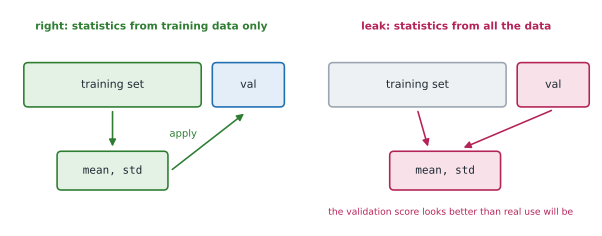

# Lesson 18: Data quality and leakage

**You'll learn:** silent data bugs, inspecting raw CSV data, missing values, impossible values, inconsistent labels, wrong units, duplicates, NaN and inf in tensors with isnan, isfinite and nan_to_num, data leakage from statistics, duplicates, augmentation and test-set reuse, stratified splits, class imbalance and class-weighted cross-entropy, accuracy on imbalanced data, sanity checks on a batch, overfitting one batch, the expected starting loss.

▶ **Practise this lesson in the [sandbox](https://kishoremadanagopal.github.io/learning/pytorch/#data-quality)**: run every example and check your exercise answers.

## Key terms

- **Data leakage:** information from validation or test data reaching training, making scores look better than real performance.
- **Imputation:** filling a missing value with an estimate, such as the training set's mean.
- **Outlier:** a value far from the rest, often an error such as a wrong unit.
- **Stratified split:** a split that keeps each class's proportion the same in every subset.
- **Class imbalance:** some classes having far more samples than others.
- **Class weights:** per-class multipliers for the loss that make mistakes on rare classes cost more.
- **Overfitting one batch:** training on a single small batch until the loss is near zero, to prove the pipeline can learn.

A code bug usually raises an error. A **data** bug usually doesn't: the model trains, the loss goes down, and the results are quietly wrong. This lesson collects the checks that catch them.

## Look at the raw data first

`fruit_raw.csv` is a messy export of the fruit data. Read it with Python's `csv` module and check every column before turning anything into tensors.

```python
import csv
from collections import Counter

with open("fruit_raw.csv", newline="") as f:
    rows = list(csv.DictReader(f))
print(len(rows), "rows")
print(Counter(r["fruit"] for r in rows))                  # spot inconsistent labels

missing = [i for i, r in enumerate(rows) if any(v.strip() == "" for v in r.values())]
print("rows with a missing value:", missing)

weights = [float(r["weight_g"]) for r in rows if r["weight_g"]]
diameters = [float(r["diameter_cm"]) for r in rows]
print("weight range:", min(weights), max(weights))       # a negative weight is impossible
print("diameter range:", min(diameters), max(diameters)) # 71 cm is a fruit measured in mm

seen, dupes = set(), 0
for r in rows:
    key = tuple(r.values())
    dupes += key in seen
    seen.add(key)
print("exact duplicates:", dupes)
```

| Problem | What it does to a model | Typical fix |
|---|---|---|
| missing value | `float("")` crashes, or a NaN spreads through training | drop the row, or fill (impute) with a training-set statistic |
| impossible value (negative weight) | drags the learned pattern | drop or correct it |
| inconsistent label ("Apple " vs "apple") | an extra, tiny class | normalise text: `.strip().lower()` |
| wrong unit (mm in a cm column) | one huge outlier dominates | fix the unit, or drop |
| duplicates | over-weights some samples; leaks across splits | remove before splitting |

## NaN in tensors

One NaN in the inputs makes the loss NaN, and then every weight becomes NaN after the next step. Check tensors with `torch.isnan` (and `torch.isfinite` for infinities too):

```python
import torch

x = torch.tensor([[1.0, 2.0], [float("nan"), 4.0], [5.0, float("inf")]])
print(torch.isnan(x).any(), torch.isfinite(x).all())
bad_rows = ~torch.isfinite(x).all(dim=1)
print(bad_rows)
print(x[~bad_rows])                         # keep only fully finite rows
print(torch.nan_to_num(x, nan=0.0, posinf=100.0))
```

## Data leakage

**Leakage** is when information from the validation or test data reaches training. The validation score then looks better than the model will really do. Common causes:

- **Fitting statistics on all the data.** Normalisation means and standard deviations (and any vocabulary, imputation value or feature scaling) must be computed on the **training** split only, then applied to the others.
- **Duplicates across splits.** The same (or nearly the same) sample in training and test lets the model score by memory. Remove duplicates before splitting.
- **Splitting after augmenting** or after cutting one record into many (frames of one video, sentences of one document): related pieces end up on both sides. Split by the original record (by patient, user or video).
- **Using the test set to make decisions** (choosing epochs or hyperparameters): that's what the validation set is for. Touch the test set once, at the end.



```python
import torch
from torch.utils.data import TensorDataset, random_split

torch.manual_seed(0)
x = torch.randn(100, 3) * torch.tensor([1.0, 50.0, 0.1]) + torch.tensor([0.0, 200.0, 5.0])
train, val = random_split(TensorDataset(x), [0.8, 0.2], generator=torch.Generator().manual_seed(0))
x_train = x[train.indices]
x_val = x[val.indices]

mean = x_train.mean(dim=0)                 # from the training split only
std = x_train.std(dim=0)
x_train_n = (x_train - mean) / std
x_val_n = (x_val - mean) / std             # the same numbers applied to validation
print(x_train_n.mean(dim=0).abs().max() < 1e-4, x_train_n.std(dim=0).round(decimals=3))   # 0 and 1 by construction
print(x_val_n.mean(dim=0).round(decimals=2))   # close to 0, not exactly: that's honest
```

## Stratified splits

A random split of a small, imbalanced dataset can leave a rare class out of the validation set by chance. A **stratified** split takes the same fraction of each class:

```python
import torch

labels = torch.tensor([0] * 50 + [1] * 28 + [2] * 12)
g = torch.Generator().manual_seed(0)
train_idx, val_idx = [], []
for c in labels.unique():
    idx = torch.nonzero(labels == c).flatten()
    idx = idx[torch.randperm(len(idx), generator=g)]
    n_val = round(0.2 * len(idx))
    val_idx += idx[:n_val].tolist()
    train_idx += idx[n_val:].tolist()
print(torch.bincount(labels[val_idx]), torch.bincount(labels[train_idx]))
```

## Imbalance: weighting the loss

Besides oversampling (lesson 3), you can keep the data as it is and make mistakes on rare classes cost more. `nn.CrossEntropyLoss(weight=...)` takes one weight per class; a common choice is n ÷ (classes × count of that class):

```python
import torch
from torch import nn

labels = torch.tensor([0] * 50 + [1] * 28 + [2] * 12)
counts = torch.bincount(labels).float()
class_weights = len(labels) / (len(counts) * counts)
print(class_weights)
loss_fn = nn.CrossEntropyLoss(weight=class_weights)
logits = torch.tensor([[2.0, 0.5, 0.1], [0.3, 0.2, 1.5]])
print(loss_fn(logits, torch.tensor([0, 2])))
```

Whatever you do about imbalance, measure it properly: with 95% negatives, a model that always says "negative" scores 95% accuracy. Look at per-class accuracy, precision and recall, not just overall accuracy.

## Sanity checks before a long training run

Take one batch from the loader and check it, then check that the model can learn it.

```python
import torch
from torch import nn, optim
from torch.utils.data import TensorDataset, DataLoader

torch.manual_seed(0)
ds = TensorDataset(torch.randn(64, 4), torch.randint(0, 3, (64,)))
xb, yb = next(iter(DataLoader(ds, batch_size=16, shuffle=True)))
print(xb.shape, xb.dtype, yb.shape, yb.dtype)            # shapes and dtypes as the model expects?
print(xb.min().item() > -10, torch.isfinite(xb).all().item())   # sensible range, no NaN?
print(torch.bincount(yb, minlength=3))                   # every class appears?

model = nn.Sequential(nn.Linear(4, 64), nn.ReLU(), nn.Linear(64, 3))
opt = optim.Adam(model.parameters(), lr=0.01)
loss_fn = nn.CrossEntropyLoss()
for step in range(200):                                  # overfit this single batch
    opt.zero_grad()
    loss = loss_fn(model(xb), yb)
    loss.backward()
    opt.step()
print(round(loss.item(), 4))                             # near 0: the pipeline can learn
```

**Overfitting one batch** is the fastest end-to-end test of a pipeline: a model with enough capacity should drive the loss on 16 examples to nearly zero. If it can't, something is broken before you've spent hours training: labels misaligned with inputs, a missing `zero_grad`, a wrong loss, or a learning rate far off. Also check the first loss: for c balanced classes, a fresh classifier's cross-entropy should be about ln(c) (1.10 for 3 classes).

## At a glance

| Concept | Code | Gives you | Remember |
|---|---|---|---|
| Find gaps | `any(v.strip() == "" for v in row.values())` / `torch.isnan(x)` | rows to drop or impute | check before `float(...)` |
| Non-finite values | `torch.isfinite(x).all()`, `torch.nan_to_num(x)` | catch NaN and inf | one NaN poisons the whole model |
| Avoid leakage | fit mean / std on `train` only, apply to val and test | honest validation scores | dedupe before splitting |
| Stratify | split each class's indexes separately | every class in every split | matters for small, imbalanced data |
| Weight the loss | `nn.CrossEntropyLoss(weight=n / (k * counts))` | rare classes matter more | one weight per class |
| Sanity check | inspect `next(iter(loader))`, overfit one batch | shapes, dtypes, ranges; loss → 0 | first loss ≈ ln(classes) |

## Common mistakes

- Turning raw data into tensors without checking for missing, impossible or inconsistent values.
- Fitting normalisation (or any preprocessing) on all the data before splitting.
- Removing duplicates after splitting, leaving copies on both sides.
- Splitting related records (frames, sentences, one patient's scans) across training and test sets.
- Judging an imbalanced classifier by overall accuracy alone.
- Starting a long training run without checking one batch's shapes, dtypes and values.

## Exercises

### 1. Clean the raw fruit

Write `clean_rows(path)` that reads a CSV like `fruit_raw.csv` with `csv.DictReader` and returns a list of cleaned rows (dicts of strings, as DictReader gives them). Apply these steps in order: (1) normalise the `fruit` label with `.strip().lower()`; (2) drop rows with any empty value; (3) drop rows whose `weight_g` isn't positive or whose `diameter_cm` is over 20; (4) drop exact duplicates of an earlier kept row, keeping the first.

Starter code:

```python
import csv

def clean_rows(path):
    pass

rows = clean_rows("fruit_raw.csv")
print(len(rows))
print(rows[0])
```

<details>
<summary>🧭 How to approach it</summary>

1. **Understand:** four filters, applied in a fixed order, keeping row order.
2. **Examples:** "Apple " becomes "apple"; a row with weight −152 is dropped; the second copy of a row is dropped.
3. **Brute force:** separate passes for each step, building new lists: fine, just longer.
4. **Pattern:** **one pass with guard clauses** and a **seen set** for duplicates.
5. **Plan:** normalise, check missing, check ranges, check duplicates, keep.
6. **Code and test:** 42 rows → 36; a case where normalising creates a duplicate.

</details>

<details>
<summary>💡 Hint 1</summary>

Read all rows with `list(csv.DictReader(f))`, then loop, `continue`-ing past the rows to drop.

</details>

<details>
<summary>💡 Hint 2</summary>

Missing values are empty strings: `any(v.strip() == "" for v in r.values())`.

</details>

<details>
<summary>💡 Hint 3</summary>

For duplicates, keep a set of `tuple(r.values())` for the rows you've kept, and normalise the label before building the tuple.

</details>

### 2. Class weights for the loss

Write `class_weights(labels, n_classes)` returning a float32 tensor of shape `[n_classes]` with weight `n ÷ (n_classes × count_c)` for each class c, where n is the number of labels. A class with no samples gets weight 0 (instead of infinity). Then build `loss_fn`, an `nn.CrossEntropyLoss` using the weights for `fruit_labels`.

Starter code:

```python
import torch
from torch import nn

def class_weights(labels, n_classes):
    pass

fruit_labels = torch.tensor([0] * 50 + [1] * 28 + [2] * 12)
loss_fn = None
print(class_weights(fruit_labels, 3))
```

<details>
<summary>🧭 How to approach it</summary>

1. **Understand:** rare classes get large weights, common ones small, so each class contributes equally to the loss on average.
2. **Examples:** 90 labels, 3 classes, 12 lemons → 90 / 36 = 2.5.
3. **Brute force:** a loop over classes with an if for empty ones.
4. **Pattern:** **bincount with minlength**, vectorised division, `where` for the zero case.
5. **Plan:** count, divide, mask, then build the loss.
6. **Code and test:** a class that never appears gets 0.

</details>

<details>
<summary>💡 Hint 1</summary>

`torch.bincount(labels, minlength=n_classes)` counts every class, including ones with no samples.

</details>

<details>
<summary>💡 Hint 2</summary>

`len(labels) / (n_classes * counts)` gives inf where a count is 0; replace those with `torch.where(counts > 0, weights, torch.zeros_like(weights))`.

</details>

<details>
<summary>💡 Hint 3</summary>

`nn.CrossEntropyLoss(weight=class_weights(fruit_labels, 3))`.

</details>

**In the sandbox:** exercises 35–36. Press **Check** to run the hidden tests.

### Answers and walkthroughs

Open these only after a real attempt. Each one explains the solution step by step.

<details>
<summary>✅ 1. Clean the raw fruit</summary>

```python
import csv

def clean_rows(path):
    with open(path, newline="") as f:
        rows = list(csv.DictReader(f))
    kept, seen = [], set()
    for r in rows:
        r["fruit"] = r["fruit"].strip().lower()
        if any(v.strip() == "" for v in r.values()):
            continue
        if float(r["weight_g"]) <= 0 or float(r["diameter_cm"]) > 20:
            continue
        key = tuple(r.values())
        if key in seen:
            continue
        seen.add(key)
        kept.append(r)
    return kept

rows = clean_rows("fruit_raw.csv")
print(len(rows))
print(rows[0])
```

**Line by line**

- Normalising the label first means "Apple " and "apple" count as the same class, and that two rows differing only in that label count as duplicates.
- The missing-value check must come before `float(...)`, because `float("")` raises a ValueError.
- `float(r["weight_g"]) <= 0` catches the impossible −152 g; `diameter_cm > 20` catches the 71 cm measured in millimetres. (Dropping is the safe default; fixing the unit is better when you're sure what happened.)
- `tuple(r.values())` makes a hashable key of the whole row; a set gives O(1) lookups.

**Order matters:** if duplicates were removed before normalising labels, " Lemon" and "lemon" rows would both survive.

**Common wrong approach:** removing duplicates *after* splitting into training and test sets. Copies of the same sample then sit on both sides of the split: leakage.

</details>

<details>
<summary>✅ 2. Class weights for the loss</summary>

```python
import torch
from torch import nn

def class_weights(labels, n_classes):
    counts = torch.bincount(labels, minlength=n_classes).float()
    weights = len(labels) / (n_classes * counts)
    return torch.where(counts > 0, weights, torch.zeros_like(weights))

fruit_labels = torch.tensor([0] * 50 + [1] * 28 + [2] * 12)
loss_fn = nn.CrossEntropyLoss(weight=class_weights(fruit_labels, 3))
print(class_weights(fruit_labels, 3))
```

**Line by line**

- `torch.bincount(labels, minlength=n_classes)` returns one count per class even if the highest classes never appear (without `minlength`, the result stops at the largest label present).
- `.float()` makes the division produce floats; dividing by a 0 count gives `inf`.
- `torch.where(counts > 0, weights, 0)` keeps finite weights and zeroes the rest; a class with no samples never appears as a target, so its weight is never used anyway.
- `nn.CrossEntropyLoss(weight=...)` multiplies each sample's loss by its class's weight and, with the default `reduction="mean"`, divides by the sum of the weights used.

**This formula** (n ÷ (classes × count)) gives weight 1 to every class when the data is perfectly balanced. It's the same as scikit-learn's `class_weight="balanced"`.

**Common wrong approach:** weights proportional to the counts (`counts / n`), which makes the common class *more* important: the opposite of the goal.

</details>

## Quick quiz

1. You normalise features with the mean and std of the whole dataset, then split into training and validation sets. What is the problem?
   - A) Data leakage: validation data influenced the preprocessing, so validation scores are optimistic
   - B) None: normalisation statistics don't depend on the data
   - C) The training set will contain NaN values
   - D) The model can no longer be saved

2. The loss becomes `nan` after a few steps. Which check should come first?
   - A) `torch.isfinite(x).all()` on the input batches (and the labels)
   - B) Increase the batch size
   - C) Switch from SGD to Adam
   - D) Call `model.eval()`

3. A 3-class classifier with random weights gives a first training loss of about 7.5 on balanced data. What does that suggest?
   - A) Something is off: the expected starting cross-entropy is about ln(3) ≈ 1.10, so check the inputs' scale, the labels or the model's output
   - B) Training is going well
   - C) The batch size is too small
   - D) The dataset is too large

4. Why overfit a single batch before a long training run?
   - A) It quickly proves the model, loss and optimizer can learn; if the loss won't approach 0 on 16 examples, the pipeline has a bug
   - B) It's the best way to get a good final model
   - C) It replaces the validation set
   - D) It calculates the normalisation statistics

5. A rare class makes up 3% of a dataset. A random 80/20 split of 100 samples might put none of it in validation. What fixes that?
   - A) A stratified split, taking 20% of each class separately
   - B) Shuffling the DataLoader
   - C) Using drop_last=True
   - D) Normalising the features

6. `nn.CrossEntropyLoss(weight=w)`: what should `w` contain?
   - A) One weight per class, larger for rarer classes
   - B) One weight per sample in the batch
   - C) One weight per model parameter
   - D) The learning rate for each class

<details>
<summary>Quiz answers</summary>

1. **A) Data leakage: validation data influenced the preprocessing, so validation scores are optimistic**: Fit preprocessing (statistics, vocabularies, imputers) on the training split only, and apply it to the others.
2. **A) `torch.isfinite(x).all()` on the input batches (and the labels)**: A single NaN or inf in the data propagates to the loss and then to every weight; also consider a too-high learning rate.
3. **A) Something is off: the expected starting cross-entropy is about ln(3) ≈ 1.10, so check the inputs' scale, the labels or the model's output**: A fresh model should be close to uniform over classes; a much larger loss points to badly scaled inputs or a bug.
4. **A) It quickly proves the model, loss and optimizer can learn; if the loss won't approach 0 on 16 examples, the pipeline has a bug**: A model that can't memorise one tiny batch usually has a wiring bug (labels, loss, zero_grad, learning rate).
5. **A) A stratified split, taking 20% of each class separately**: Stratification preserves each class's proportion in every split.
6. **A) One weight per class, larger for rarer classes**: The class weights multiply each sample's loss according to its target class.

</details>

---
Previous: [Lesson 17](17-transforms.md) · Back to the [course home](../README.md)
