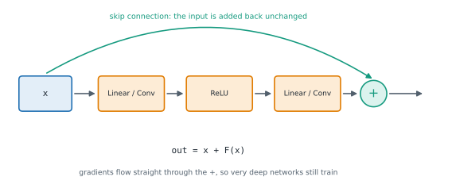

# Lesson 21: Training deeper networks well

**You'll learn:** vanishing and exploding gradients, ReLU, LeakyReLU, GELU and SiLU, sigmoid and tanh saturation, Kaiming and Xavier initialisation, nn.init and model.apply, why not to initialise all weights equally, BatchNorm versus LayerNorm, residual connections and skip paths, pre-norm residual blocks, regularisation with dropout, weight decay, augmentation and smaller models, early stopping with the best weights, gradient clipping.

▶ **Practise this lesson in the [sandbox](https://kishoremadanagopal.github.io/learning/pytorch/#better-models)**: run every example and check your exercise answers.

## Key terms

- **Vanishing gradient:** gradients shrinking as they pass back through many layers, so early layers barely learn.
- **Exploding gradient:** gradients growing as they pass back through many layers, making training unstable.
- **GELU:** a smooth activation, x·Φ(x), standard in Transformers.
- **Kaiming (He) initialisation:** random weights with std √(2 / fan_in), suited to ReLU networks.
- **Xavier (Glorot) initialisation:** random weights scaled by fan_in and fan_out, suited to tanh and sigmoid.
- **Fan-in:** the number of inputs feeding each unit of a layer.
- **Residual (skip) connection:** adding a block's input to its output, `x + F(x)`.
- **Regularisation:** techniques that reduce overfitting, such as dropout, weight decay and augmentation.
- **Early stopping:** ending training when validation loss stops improving and keeping the best weights.
- **Gradient clipping:** rescaling gradients so their norm doesn't exceed a limit.

Stacking more layers lets a network learn more complex functions, but deep networks are hard to train unless a few things are right. Each technique here fixes a specific problem.

## Vanishing and exploding gradients

Backpropagation multiplies one factor per layer. If those factors are mostly below 1, the gradient reaching the first layers **vanishes** and they barely learn; if mostly above 1, it **explodes**. Sigmoid is a classic culprit: its slope is at most 0.25.

```python
import torch
from torch import nn

def first_layer_grad(activation, depth=20):
    torch.manual_seed(0)
    layers = []
    for _ in range(depth):
        layers += [nn.Linear(32, 32), activation()]
    net = nn.Sequential(*layers)
    net(torch.randn(16, 32)).sum().backward()
    return net[0].weight.grad.abs().mean().item()

print(f"sigmoid: {first_layer_grad(nn.Sigmoid):.2e}")
print(f"relu:    {first_layer_grad(nn.ReLU):.2e}")
```

## Activations

| Activation | Formula | Notes |
|---|---|---|
| `nn.ReLU()` | max(0, x) | fast, the default for CNNs; units can "die" (stay at 0) |
| `nn.LeakyReLU(0.01)` | x if x > 0 else 0.01·x | a small slope for negatives, so units can't die |
| `nn.GELU()` | x·Φ(x) | smooth; the standard in Transformers |
| `nn.SiLU()` | x·sigmoid(x) | smooth (also called Swish); common in modern CNNs and LLMs |
| `nn.Tanh()`, `nn.Sigmoid()` | squash to (−1, 1), (0, 1) | for outputs and gates; avoid stacking many |

```python
import torch
from torch import nn

x = torch.tensor([-2.0, -0.5, 0.0, 0.5, 2.0])
for act in (nn.ReLU(), nn.LeakyReLU(0.1), nn.GELU(), nn.SiLU()):
    print(f"{type(act).__name__:<10}", act(x))
```

## Initialisation

Weights must start at the right scale, so each layer's outputs have roughly the same spread as its inputs. PyTorch's layers already initialise sensibly (Linear and Conv use a Kaiming-uniform variant). When you build very deep networks, or want a specific scheme, `torch.nn.init` has the standard ones:

| Scheme | Spread | For |
|---|---|---|
| `kaiming_normal_(w, nonlinearity="relu")` | std = √(2 / fan_in) | ReLU-family networks |
| `xavier_uniform_(w)` (Glorot) | bound = √(6 / (fan_in + fan_out)) | tanh / sigmoid, attention projections |
| `zeros_(b)`, `ones_`, `constant_` | | biases, norm layers |

`model.apply(fn)` calls `fn` on every submodule, the usual way to initialise a whole model:

```python
import torch
from torch import nn

def init_weights(m):
    if isinstance(m, nn.Linear):
        nn.init.kaiming_normal_(m.weight, nonlinearity="relu")
        nn.init.zeros_(m.bias)

torch.manual_seed(0)
model = nn.Sequential(nn.Linear(256, 256), nn.ReLU(), nn.Linear(256, 10))
model.apply(init_weights)
print(round(model[0].weight.std().item(), 3), round((2 / 256) ** 0.5, 3))
print(model[2].bias)
```

Never initialise all weights to the **same** value (such as zeros): every unit in a layer would compute the same thing and receive the same gradient, so they'd stay identical forever.

## Normalisation layers

| Layer | Normalises over | Typical use |
|---|---|---|
| `nn.BatchNorm1d/2d` | the batch (and pixels), per feature or channel | CNNs with decent batch sizes; behaves differently in train and eval |
| `nn.LayerNorm(d)` | the features of each sample separately | Transformers and RNNs; same in train and eval; works with batch size 1 |

## Residual connections

A **residual connection** adds a block's input to its output: `out = x + F(x)`. The block only has to learn the *change* F(x), and gradients flow straight back through the addition. This is what made networks with 100+ layers trainable (ResNet, 2015), and every Transformer layer uses it.



```python
import torch
from torch import nn

class Residual(nn.Module):
    def __init__(self, dim):
        super().__init__()
        self.block = nn.Sequential(nn.Linear(dim, dim), nn.ReLU(), nn.Linear(dim, dim))

    def forward(self, x):
        return x + self.block(x)          # shapes must match for the addition

torch.manual_seed(0)
deep = nn.Sequential(*[Residual(32) for _ in range(20)], nn.Linear(32, 1))
deep(torch.randn(16, 32)).sum().backward()
print(f"first-layer gradient: {deep[0].block[0].weight.grad.abs().mean().item():.2e}")
```

## Regularisation: fighting overfitting

| Technique | How | Effect |
|---|---|---|
| more data, augmentation | Part 3 | the best fix when possible |
| dropout | `nn.Dropout(p)` between layers | randomly zeroes units in training, so no unit can rely on another |
| weight decay | `optim.AdamW(..., weight_decay=0.01)` | pulls weights towards 0 each step |
| early stopping | stop when validation loss stops improving, keep the best weights | uses the validation set to pick the epoch |
| smaller model | fewer layers or units | less capacity to memorise |

```python
import copy

def train_with_early_stopping(train_epoch, val_loss, model, patience=3, max_epochs=100):
    best, best_state, bad_epochs = float("inf"), None, 0
    for epoch in range(max_epochs):
        train_epoch()
        loss = val_loss()
        if loss < best:
            best, best_state, bad_epochs = loss, copy.deepcopy(model.state_dict()), 0
        else:
            bad_epochs += 1
            if bad_epochs >= patience:
                break
    model.load_state_dict(best_state)
    return best, epoch

losses = iter([0.9, 0.7, 0.6, 0.62, 0.61, 0.65, 0.5])
import torch
from torch import nn
m = nn.Linear(2, 1)
print(train_with_early_stopping(lambda: None, lambda: next(losses), m, patience=3))
```

## Gradient clipping

For exploding gradients (common in RNNs and large Transformers), rescale the gradients before the optimizer step so their combined norm is at most a limit:

```python
loss.backward()
torch.nn.utils.clip_grad_norm_(model.parameters(), max_norm=1.0)
optimizer.step()
```

## At a glance

| Concept | Code | Gives you | Remember |
|---|---|---|---|
| Default activation | `nn.ReLU()` (CNNs), `nn.GELU()` (Transformers) | non-linearity without saturation | sigmoid's slope ≤ 0.25 |
| Initialise | `model.apply(fn)` with `nn.init.kaiming_normal_(w, nonlinearity="relu")` | stable activation scale | zeros_ for biases |
| Normalise | BatchNorm for CNNs, LayerNorm for sequences | stable, faster training | LayerNorm is batch-independent |
| Go deep | `x + block(x)` | trainable 100+ layer networks | shapes must match |
| Regularise | Dropout, `AdamW(weight_decay=…)`, augmentation | less overfitting | only training behaviour changes |
| Stop early | keep `copy.deepcopy(model.state_dict())` of the best epoch | best validation weights | patience = epochs to wait |
| Clip | `clip_grad_norm_(params, 1.0)` between backward and step | bounded updates | returns the norm before clipping |

## Common mistakes

- Stacking many sigmoid or tanh layers in a deep network.
- Initialising all weights to the same value (zeros), so every unit learns the same thing.
- Calling init functions without the trailing underscore, or on norm layers.
- Writing a residual block whose output shape differs from its input's.
- Keeping the last epoch's weights instead of the best validation epoch's.
- Clipping gradients before `backward()` or after `step()`.

## Exercises

### 1. A residual block

Write a class `ResidualBlock(nn.Module)` whose constructor takes `dim`. It has `self.norm` = LayerNorm(dim), `self.fc1` = Linear(dim, 4 × dim), `self.act` = GELU(), `self.fc2` = Linear(4 × dim, dim). `forward(x)` returns `x + fc2(act(fc1(norm(x))))`: a pre-norm residual feed-forward block, as in modern Transformers.

Starter code:

```python
import torch
from torch import nn

class ResidualBlock(nn.Module):
    pass

block = ResidualBlock(8)
print(block(torch.randn(2, 5, 8)).shape)
```

<details>
<summary>🧭 How to approach it</summary>

1. **Understand:** a sub-network whose output is added to its input.
2. **Examples:** if fc2 outputs zeros, the block is the identity, which is why residual networks start out easy to train.
3. **Brute force:** no shortcut; it's four layers and one addition.
4. **Pattern:** **pre-norm residual**: normalise, transform, add back.
5. **Plan:** define layers; compose them; add x.
6. **Code and test:** zero fc2 and check the output equals the input.

</details>

<details>
<summary>💡 Hint 1</summary>

Four layers in `__init__`, created after `super().__init__()`.

</details>

<details>
<summary>💡 Hint 2</summary>

The block computes `self.fc2(self.act(self.fc1(self.norm(x))))`.

</details>

<details>
<summary>💡 Hint 3</summary>

Return `x +` that: the skip connection.

</details>

### 2. Initialise a model for ReLU

Write `init_weights(m)` for use with `model.apply`: for every `nn.Linear` and `nn.Conv2d`, fill the weight with `nn.init.kaiming_normal_(..., nonlinearity="relu")` and set the bias (if it has one) to zeros; leave every other kind of module alone.

Starter code:

```python
import torch
from torch import nn

def init_weights(m):
    pass

torch.manual_seed(0)
model = nn.Sequential(nn.Conv2d(3, 16, 3), nn.ReLU(), nn.Flatten(), nn.Linear(16 * 30 * 30, 10))
model.apply(init_weights)
print(model[0].bias[:3], round(model[3].weight.std().item(), 4))
```

<details>
<summary>🧭 How to approach it</summary>

1. **Understand:** a function applied to every module; only some module types should change.
2. **Examples:** a Linear with 4096 inputs gets weights with std ≈ √(2/4096) ≈ 0.022.
3. **Brute force:** loop over `model.modules()` yourself: equivalent to `apply`.
4. **Pattern:** **type dispatch** inside an init function.
5. **Plan:** isinstance check; init weight; zero the bias if present.
6. **Code and test:** a layer without bias and norm layers that must stay untouched.

</details>

<details>
<summary>💡 Hint 1</summary>

`isinstance(m, (nn.Linear, nn.Conv2d))` checks both types at once.

</details>

<details>
<summary>💡 Hint 2</summary>

`nn.init.kaiming_normal_(m.weight, nonlinearity="relu")` works in place (note the trailing underscore).

</details>

<details>
<summary>💡 Hint 3</summary>

Layers created with `bias=False` have `m.bias is None`: check before zeroing.

</details>

**In the sandbox:** exercises 41–42. Press **Check** to run the hidden tests.

### Answers and walkthroughs

Open these only after a real attempt. Each one explains the solution step by step.

<details>
<summary>✅ 1. A residual block</summary>

```python
import torch
from torch import nn

class ResidualBlock(nn.Module):
    def __init__(self, dim):
        super().__init__()
        self.norm = nn.LayerNorm(dim)
        self.fc1 = nn.Linear(dim, 4 * dim)
        self.act = nn.GELU()
        self.fc2 = nn.Linear(4 * dim, dim)

    def forward(self, x):
        return x + self.fc2(self.act(self.fc1(self.norm(x))))

block = ResidualBlock(8)
print(block(torch.randn(2, 5, 8)).shape)
```

**Line by line**

- `LayerNorm(dim)` normalises each position's features; applying it *before* the block ("pre-norm") keeps the skip path completely untouched.
- `fc1` expands to 4 × dim, `GELU` adds the non-linearity, `fc2` projects back so the shapes match for the addition. That 4× expansion is the standard Transformer feed-forward size.
- `x + ...` is the residual connection. Its gradient with respect to x includes an identity term, so gradients reach earlier layers even if the block's own gradient is tiny.

**Common wrong approach:** `self.fc2(...) + self.norm(x)`, adding the *normalised* input. The skip should carry the original x.

</details>

<details>
<summary>✅ 2. Initialise a model for ReLU</summary>

```python
import torch
from torch import nn

def init_weights(m):
    if isinstance(m, (nn.Linear, nn.Conv2d)):
        nn.init.kaiming_normal_(m.weight, nonlinearity="relu")
        if m.bias is not None:
            nn.init.zeros_(m.bias)

torch.manual_seed(0)
model = nn.Sequential(nn.Conv2d(3, 16, 3), nn.ReLU(), nn.Flatten(), nn.Linear(16 * 30 * 30, 10))
model.apply(init_weights)
print(model[0].bias[:3], round(model[3].weight.std().item(), 4))
```

**Line by line**

- `model.apply(fn)` visits every submodule (children first, then the module itself) and calls `fn` on it; Sequential, ReLU and the norm layers are visited too, so the type check matters.
- `kaiming_normal_` draws from a normal distribution with std = √(2 / fan_in): the factor 2 compensates for ReLU zeroing half its inputs, so the signal's variance stays constant through the layers. For a conv, fan_in = in_channels × kH × kW (3 × 3 × 3 = 27 here).
- `m.bias is not None` handles `bias=False` layers.

**Common wrong approach:** `nn.init.kaiming_normal(m.weight)` without the underscore (old, removed names), or initialising the norm layers' weights randomly. Norm layers start at weight 1, bias 0 so they begin as plain normalisation.

</details>

## Quick quiz

1. A 30-layer network with sigmoid activations barely learns: its first layers' gradients are near zero. What is this, and a standard fix?
   - A) Exploding gradients; lower the batch size
   - B) Vanishing gradients; use ReLU-family activations, proper initialisation, normalisation and residual connections
   - C) Underfitting; remove layers
   - D) Overfitting; add dropout

2. Which initialisation suits layers followed by ReLU?
   - A) A constant 0.01
   - B) Kaiming (He): std = √(2 / fan_in)
   - C) Xavier with gain 1 for every network
   - D) All zeros

3. Why are Transformers built with LayerNorm rather than BatchNorm?
   - A) BatchNorm can't be used on GPUs
   - B) LayerNorm is faster to compute than a linear layer
   - C) LayerNorm normalises each sample's features on its own, so it doesn't depend on the batch, behaves the same in training and inference, and handles variable-length sequences
   - D) LayerNorm has no learnable parameters

4. What does a residual connection compute?
   - A) `out = x + F(x)`
   - B) `out = F(F(x))`
   - C) `out = F(x) − x`
   - D) `out = x · F(x)`

5. Validation loss stops improving after epoch 12 while training loss keeps falling. With early stopping (patience 3), which weights should you keep?
   - A) The initial weights
   - B) The weights from epoch 15, when training stopped
   - C) The weights from the last epoch
   - D) The weights from epoch 12, the best validation loss

<details>
<summary>Quiz answers</summary>

1. **B) Vanishing gradients; use ReLU-family activations, proper initialisation, normalisation and residual connections**: Sigmoid's slope is at most 0.25, and the factors multiply through every layer.
2. **B) Kaiming (He): std = √(2 / fan_in)**: The factor 2 compensates for ReLU discarding the negative half of its inputs.
3. **C) LayerNorm normalises each sample's features on its own, so it doesn't depend on the batch, behaves the same in training and inference, and handles variable-length sequences**: BatchNorm's statistics depend on the batch and on padding, which suits sequence models poorly.
4. **A) `out = x + F(x)`**: The block learns a change to its input, and gradients pass through the addition unchanged.
5. **D) The weights from epoch 12, the best validation loss**: Early stopping saves a copy of the best state_dict and restores it at the end.

</details>

---
Previous: [Lesson 20](20-sequence-layers.md) · Next: [Lesson 22: Optimizers and learning-rate schedules](22-optimizers-and-schedules.md)
