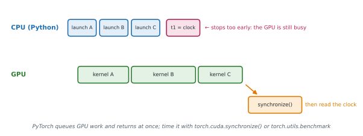

# Lesson 24: Measuring performance

**You'll learn:** measuring before optimising, time.perf_counter, warm-up runs and the median, asynchronous GPU execution and torch.cuda.synchronize, CUDA events, torch.utils.benchmark.Timer and blocked_autorange, torch.profiler.profile with activities, record_function, key_averages and the profiler table (Self CPU versus CPU total, number of calls), record_shapes, profile_memory, schedule and prof.step, trace export for Perfetto and TensorBoard, GPU memory statistics (memory_allocated, max_memory_allocated, memory_reserved, reset_peak_memory_stats, empty_cache), what uses memory during training, fixes for out-of-memory errors, telling data-loading bottlenecks from compute bottlenecks.

▶ **Practise this lesson in the [sandbox](https://kishoremadanagopal.github.io/learning/pytorch/#measuring-performance)**: run every example and check your exercise answers.

## Key terms

- **Warm-up:** untimed first runs that absorb one-time costs such as memory allocation, algorithm selection and compilation.
- **Asynchronous execution:** the CPU queues GPU kernels and continues without waiting for them to finish.
- **Synchronisation:** waiting until the GPU has finished all queued work (`torch.cuda.synchronize()`, or implicitly via `.item()`, `.cpu()`, `print`).
- **Profiler:** a tool that records every operation run, how often, and how long it took (`torch.profiler.profile`).
- **Self time:** time spent in an operation itself, excluding the operations it called.
- **Trace:** a timeline file of recorded events, viewable in Perfetto or TensorBoard.
- **Caching allocator:** PyTorch's GPU memory manager, which keeps freed blocks reserved for reuse.
- **Peak memory:** the highest memory use during a period (`max_memory_allocated`), which decides whether a batch fits.
- **Activation checkpointing:** recomputing activations during backward instead of storing them, trading compute for memory.
- **Bottleneck:** the slowest part of the pipeline, which limits overall speed.

Optimising without measuring usually speeds up the wrong thing. The workflow is: **measure**, find the biggest cost, change one thing, measure again.

(This sandbox runs PyTorch as Python on NumPy, so its timings say nothing about real PyTorch speed. The tools and their output work the same way, so practise reading them here and use them for real on your own machine.)

## Timing code correctly

Three rules:

1. Use `time.perf_counter()`, a high-resolution clock.
2. **Warm up** first. The first calls are slower (memory allocation, cuDNN choosing algorithms, `torch.compile` compiling), so leave them out.
3. Repeat and take the **median**, which ignores occasional slow runs.

```python
import time
import torch
from torch import nn

torch.manual_seed(0)
model = nn.Sequential(nn.Linear(256, 256), nn.ReLU(), nn.Linear(256, 10))
x = torch.randn(64, 256)

for _ in range(3):                           # warm-up
    model(x)
times = []
for _ in range(20):
    start = time.perf_counter()
    model(x)
    times.append(time.perf_counter() - start)
times.sort()
print(f"median {times[len(times) // 2] * 1e3:.3f} ms")
```

## The GPU runs asynchronously

When Python calls a GPU operation, PyTorch **queues** the kernel and returns immediately; the GPU works through the queue in the background. A clock read straight after the call measures only the launch. Call `torch.cuda.synchronize()` (wait until the GPU has finished everything queued) before reading the clock each time.



```python
torch.cuda.synchronize()
start = time.perf_counter()
y = model(x)
torch.cuda.synchronize()                     # wait for the GPU before stopping the clock
elapsed = time.perf_counter() - start

start_evt = torch.cuda.Event(enable_timing=True)   # or time on the GPU itself with CUDA events
end_evt = torch.cuda.Event(enable_timing=True)
start_evt.record()
y = model(x)
end_evt.record()
torch.cuda.synchronize()
print(start_evt.elapsed_time(end_evt), "ms")
```

Anything that copies a value to the CPU (`.item()`, `.cpu()`, `print(tensor)`) also synchronises, which is why scattering `.item()` calls through a training loop slows it down.

## torch.utils.benchmark

`torch.utils.benchmark.Timer` does the warm-up, the repetitions and the CUDA synchronisation for you, and reports statistics:

```python
import torch
import torch.utils.benchmark as benchmark

x = torch.randn(64, 64)
t = benchmark.Timer(stmt="x @ x", globals={"x": x})
m = t.blocked_autorange(min_run_time=0.2)        # repeat until 0.2 s of measurements
print(m)
print(m.median > 0, len(m.times) >= 3)
```

## The profiler

Timing tells you *how long*; the **profiler** tells you *where the time goes*: every operation PyTorch ran, how many times, and for how long.

```python
import torch
from torch import nn
from torch.profiler import profile, record_function, ProfilerActivity

torch.manual_seed(0)
model = nn.Sequential(nn.Linear(64, 128), nn.ReLU(), nn.Linear(128, 10))
x = torch.randn(32, 64)
opt = torch.optim.SGD(model.parameters(), lr=0.1)

with profile(activities=[ProfilerActivity.CPU], record_shapes=True) as prof:
    with record_function("forward"):            # label your own regions
        loss = model(x).sum()
    loss.backward()
    opt.step()

print(prof.key_averages().table(sort_by="cpu_time_total", row_limit=8))
counts = {e.key: e.count for e in prof.key_averages()}
print(counts["aten::linear"], counts["forward"])
```

How to read the table:

| Column | Meaning |
|---|---|
| Name | `aten::…` are PyTorch's operators; `autograd::engine::evaluate_function: …Backward0` is backward; `Optimizer.step#…` is the update; your `record_function` labels appear too |
| Self CPU | time in the operation itself, excluding operations it called |
| CPU total | including everything it called |
| # of Calls | how many times it ran |

With `activities=[ProfilerActivity.CPU, ProfilerActivity.CUDA]` on a GPU machine the table adds GPU columns (`Self CUDA`, `CUDA total`), and `sort_by="cuda_time_total"` shows which kernels dominate. (The sandbox has no real GPU, so it records CPU time only.) `profile_memory=True` adds memory columns; `group_by_input_shape=True` (with `record_shapes=True`) splits rows by tensor shapes.

For long training runs, profile a few steps with a **schedule**, and write traces you can open in Perfetto (`ui.perfetto.dev`) or TensorBoard:

```python
from torch.profiler import schedule, tensorboard_trace_handler

with profile(activities=[ProfilerActivity.CPU, ProfilerActivity.CUDA],
             schedule=schedule(wait=1, warmup=1, active=3, repeat=1),
             on_trace_ready=tensorboard_trace_handler("./log/profile")) as prof:
    for step, (xb, yb) in enumerate(loader):
        train_step(xb, yb)
        prof.step()                    # tell the profiler a step ended
        if step >= 5:
            break
```

`wait` steps are ignored, `warmup` steps are profiled but discarded (start-up costs), and `active` steps are recorded. `prof.export_chrome_trace("trace.json")` writes a timeline file directly.

## Memory

GPU memory often limits batch size and model size before speed does.

| Call | Returns |
|---|---|
| `torch.cuda.memory_allocated()` | bytes held by tensors right now |
| `torch.cuda.max_memory_allocated()` | the peak since the start (or since `reset_peak_memory_stats()`) |
| `torch.cuda.memory_reserved()` | bytes the caching allocator holds, including freed blocks it keeps for reuse |
| `torch.cuda.empty_cache()` | gives cached, unused blocks back to the driver (doesn't free live tensors) |

```python
import torch
from torch import nn

torch.cuda.reset_peak_memory_stats()
model = nn.Linear(1024, 1024).cuda()
x = torch.randn(256, 1024, device="cuda")
print(torch.cuda.memory_allocated() // 1024, "KiB")      # weights 4096 + bias 4 + input 1024
y = model(x)
print(y.nelement() * y.element_size() // 1024, "KiB for the output")
print(torch.cuda.max_memory_allocated() >= torch.cuda.memory_allocated())
```

(On a real GPU the numbers also include small allocator rounding and the workspace cuBLAS reserves for matmuls, so expect slightly more.)

During training, memory holds the weights, the gradients, the optimizer state (Adam keeps two extra values per weight) and the **activations** saved for backward, which grow with batch size. When you run out of memory (`torch.OutOfMemoryError`): use a smaller batch with gradient accumulation (Part 4), mixed precision (lesson 26), activation checkpointing (`torch.utils.checkpoint`, which recomputes activations during backward instead of storing them), or sharding across GPUs (lesson 27).

## Find the bottleneck first

| Symptom | Likely bottleneck | Fixes |
|---|---|---|
| GPU utilisation low (`nvidia-smi`), the profiler shows time in `enumerate(DataLoader)` | data loading | `num_workers`, `pin_memory=True`, faster decoding, prepare data in advance |
| GPU busy, many small kernels | Python and launch overhead | `torch.compile`, bigger batches |
| GPU busy on matmuls and convolutions | the maths itself | mixed precision, TF32, a smaller or more efficient model |
| out of memory | activations, optimizer state | the memory list above |

## At a glance

| Concept | Code | Gives you | Remember |
|---|---|---|---|
| Time CPU code | `time.perf_counter()` around the call | seconds | warm up, repeat, take the median |
| Time GPU code | `torch.cuda.synchronize()` before both clock reads | the real duration | or CUDA events / `benchmark.Timer` |
| Benchmark | `benchmark.Timer(stmt, globals=...).blocked_autorange()` | `Measurement` (median, iqr) | handles warm-up and sync |
| Profile | `with profile(activities=[ProfilerActivity.CPU, ProfilerActivity.CUDA]) as prof:` | recorded events | `record_function("name")` labels regions |
| Summarise | `prof.key_averages().table(sort_by="cpu_time_total", row_limit=10)` | per-operation table | Self excludes children; Total includes them |
| Long runs | `schedule(wait, warmup, active)` + `prof.step()` | a few profiled steps | `tensorboard_trace_handler` / `export_chrome_trace` |
| Memory | `torch.cuda.max_memory_allocated()` | peak bytes | reset with `reset_peak_memory_stats()` |
| Out of memory | smaller batch + accumulation, AMP, checkpointing, FSDP | fits | activations grow with batch size |

## Common mistakes

- Timing GPU code without synchronising, which measures only the kernel launch.
- Including the first (warm-up or compile) call in timings.
- Reporting a single run instead of the median of several.
- Calling `.item()` or printing tensors every step, which forces a synchronisation each time.
- Reading memory_reserved as memory used by tensors.
- Expecting `empty_cache()` to free tensors that are still referenced.
- Optimising the model when the GPU is actually waiting for data.

## Exercises

### 1. Time a function properly

Write `time_fn(fn, warmup=3, repeats=10)` that calls `fn()` `warmup` times without timing it, then `repeats` times, measuring each call with `time.perf_counter()`, and returns the **median** duration in seconds. If a CUDA GPU is available, call `torch.cuda.synchronize()` before starting and before stopping the clock for each timed call.

Starter code:

```python
import time
import torch

def time_fn(fn, warmup=3, repeats=10):
    pass

x = torch.randn(64, 64)
print(f"{time_fn(lambda: x @ x) * 1e6:.1f} microseconds")
```

<details>
<summary>🧭 How to approach it</summary>

1. **Understand:** warm up, time each call separately, report a robust statistic.
2. **Examples:** timed durations 5, 1, 30, 3, 7 → median 5 (the mean, 9.2, is pulled up by the one slow call).
3. **Brute force:** time all repeats in one block and divide: the mean, which slow outliers distort.
4. **Pattern:** **warm-up + per-call timing + median**, with **synchronisation** around GPU work.
5. **Plan:** warm-up loop; timed loop with sync; median.
6. **Code and test:** the check replaces the clock with a fake one, so the answer is exact.

</details>

<details>
<summary>💡 Hint 1</summary>

A plain loop of `fn()` calls handles the warm-up.

</details>

<details>
<summary>💡 Hint 2</summary>

For each timed call: synchronize, `start = time.perf_counter()`, `fn()`, synchronize, then append `time.perf_counter() - start`.

</details>

<details>
<summary>💡 Hint 3</summary>

`statistics.median(times)` averages the two middle values when the count is even.

</details>

### 2. Count operations with the profiler

Write `op_counts(fn, names)` that runs `fn()` inside `torch.profiler.profile` (CPU activity) and returns a dict mapping each name in `names` to how many times that event occurred (0 if it never ran), using `prof.key_averages()`.

Starter code:

```python
import torch
from torch import nn
from torch.profiler import profile, ProfilerActivity

def op_counts(fn, names):
    pass

model = nn.Sequential(nn.Linear(4, 8), nn.ReLU(), nn.Linear(8, 2))
x = torch.randn(3, 4)
print(op_counts(lambda: model(x).sum().backward(), ["aten::linear", "aten::relu", "aten::conv2d"]))
```

<details>
<summary>🧭 How to approach it</summary>

1. **Understand:** run under the profiler, then aggregate events by name.
2. **Examples:** three Linear layers → `aten::linear` 3 times per forward pass.
3. **Brute force:** add counters to the model by hand: doesn't work for library code you can't edit.
4. **Pattern:** **profile → key_averages → look up**.
5. **Plan:** profile; dict of key → count; answer for each name.
6. **Code and test:** names that never ran give 0.

</details>

<details>
<summary>💡 Hint 1</summary>

`with profile(activities=[ProfilerActivity.CPU]) as prof: fn()`.

</details>

<details>
<summary>💡 Hint 2</summary>

Each entry of `prof.key_averages()` has `.key` (the name) and `.count`.

</details>

<details>
<summary>💡 Hint 3</summary>

Build a dict from them, then look up each requested name with `.get(name, 0)`.

</details>

**In the sandbox:** exercises 47–48. Press **Check** to run the hidden tests.

### Answers and walkthroughs

Open these only after a real attempt. Each one explains the solution step by step.

<details>
<summary>✅ 1. Time a function properly</summary>

```python
import statistics
import time
import torch

def time_fn(fn, warmup=3, repeats=10):
    for _ in range(warmup):
        fn()
    times = []
    for _ in range(repeats):
        if torch.cuda.is_available():
            torch.cuda.synchronize()
        start = time.perf_counter()
        fn()
        if torch.cuda.is_available():
            torch.cuda.synchronize()
        times.append(time.perf_counter() - start)
    return statistics.median(times)

x = torch.randn(64, 64)
print(f"{time_fn(lambda: x @ x) * 1e6:.1f} microseconds")
```

**Line by line**

- The warm-up calls absorb one-time costs (allocations, algorithm selection, compilation) that would otherwise inflate the first measurements.
- `torch.cuda.synchronize()` before `start` makes sure earlier queued GPU work isn't counted; the one after `fn()` makes sure this call's GPU work is.
- `statistics.median` resists outliers such as a garbage-collection pause or another program using the GPU.

**Common wrong approach:** timing without synchronising on a GPU, which can report microseconds for a matmul that really takes milliseconds.

</details>

<details>
<summary>✅ 2. Count operations with the profiler</summary>

```python
import torch
from torch import nn
from torch.profiler import profile, ProfilerActivity

def op_counts(fn, names):
    with profile(activities=[ProfilerActivity.CPU]) as prof:
        fn()
    counts = {e.key: e.count for e in prof.key_averages()}
    return {name: counts.get(name, 0) for name in names}

model = nn.Sequential(nn.Linear(4, 8), nn.ReLU(), nn.Linear(8, 2))
x = torch.randn(3, 4)
print(op_counts(lambda: model(x).sum().backward(), ["aten::linear", "aten::relu", "aten::conv2d"]))
```

**Line by line**

- Inside the `with` block every operator call, backward node and optimizer step is recorded as an event.
- `key_averages()` groups events with the same name and sums their counts and times; each group has `.key`, `.count`, `.cpu_time_total` and `.self_cpu_time_total`.
- Missing names get 0 through `.get`.

**Why counts matter:** an operation that runs far more often than expected (a `.to()` copy inside a loop, an `aten::item` per step) is a common hidden cost, and counts are stable from run to run while times vary.

**Common wrong approach:** reading `prof.events()` and counting by hand: it works, but key_averages already does it.

</details>

## Quick quiz

1. You time `y = model(x)` on a GPU with `time.perf_counter()` before and after, without anything else. What is wrong?
   - A) The model must be in eval mode to be timed
   - B) perf_counter can't measure GPU code at all
   - C) GPU operations are asynchronous, so the call returns before the work finishes; synchronize before reading the clock
   - D) Nothing: the measurement is accurate

2. In the profiler table, what is the difference between "Self CPU" and "CPU total"?
   - A) They are always equal
   - B) Self CPU excludes the time spent in operations it called; CPU total includes them
   - C) Self CPU is for the forward pass, CPU total for backward
   - D) Self CPU counts one call, CPU total all calls

3. With `schedule(wait=1, warmup=1, active=3)`, which steps are recorded?
   - A) Only the warm-up step
   - B) Steps 1 to 3
   - C) Steps 3, 4 and 5 (after skipping 1 and warming up for 1), with `prof.step()` marking each step
   - D) Every step

4. Training uses little of the GPU, and the profiler shows most time in `enumerate(DataLoader)`. What should you try first?
   - A) A bigger model
   - B) More DataLoader workers (num_workers) and pin_memory=True
   - C) torch.compile
   - D) A higher learning rate

5. What does `torch.cuda.max_memory_allocated()` report?
   - A) Memory reserved by the caching allocator right now
   - B) The memory used by the current process on the CPU
   - C) The peak memory used by tensors since the start or the last `reset_peak_memory_stats()`
   - D) The GPU's total memory

<details>
<summary>Quiz answers</summary>

1. **C) GPU operations are asynchronous, so the call returns before the work finishes; synchronize before reading the clock**: Use torch.cuda.synchronize() (or torch.utils.benchmark, or CUDA events) around the timed region.
2. **B) Self CPU excludes the time spent in operations it called; CPU total includes them**: An aten::linear row's CPU total includes the aten::addmm it calls; its self time doesn't.
3. **C) Steps 3, 4 and 5 (after skipping 1 and warming up for 1), with `prof.step()` marking each step**: Waiting and warm-up steps aren't recorded; warm-up excludes start-up costs from the trace.
4. **B) More DataLoader workers (num_workers) and pin_memory=True**: The GPU is waiting for data; speeding up the model won't help.
5. **C) The peak memory used by tensors since the start or the last `reset_peak_memory_stats()`**: Use it to find the peak during a training step, which decides whether a batch size fits.

</details>

---
Previous: [Lesson 23](23-transfer-learning.md) · Next: [Lesson 25: torch.compile and execution speed-ups](25-torch-compile.md)
