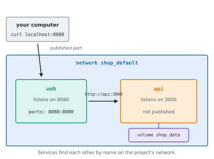

# Lesson 23: Docker Compose: several containers together

**You'll learn:** why Compose, compose.yaml and its services (build, image, ports, environment), the project name, docker compose up -d, ps, logs, exec, stop and down (-v), the project network and service names as host names, localhost inside a container, the default bridge network has no names, depends_on and its conditions (service_started, service_healthy, service_completed_successfully), healthcheck in Compose, named volumes in Compose (project_volume names), restart, environment interpolation from the shell and .env with defaults, docker compose config, the obsolete version key and the retired docker-compose program, Compose 5, develop.watch (sync, sync+restart, rebuild) and docker compose watch, compose.override.yaml, adding a database service.

▶ **Practise this lesson in the [sandbox](https://kishoremadanagopal.github.io/learning/shipping/#compose)**: run every example and check your exercise answers.

## Key terms

- **Docker Compose:** a tool that runs a multi-container app described in compose.yaml.
- **Service:** one container definition in a Compose file.
- **Project:** a Compose app; its name (the folder by default) prefixes containers, networks and volumes.
- **Service discovery:** finding another service by its name on the project network.
- **depends_on:** start-order rules between services, optionally waiting for health.
- **Interpolation:** filling ${VAR} in compose.yaml from the environment or .env.
- **Compose watch:** keeping containers in sync with files you edit, by copying or rebuilding.

The `docker run` commands in the last lesson were already long. A real app has several parts (an API, a website, a database, a queue), each with its own options, and they must find each other. **Docker Compose** describes all of them in one file, `compose.yaml`, and starts them with one command.

## A compose.yaml

The shop now has a storefront in `web/`: a second small server that fetches the prices from the API and shows them as a page. Its `API_URL` variable says where the API is.

<details><summary>Commands that set up this example (run them first on your own computer)</summary>

```bash
mkdir -p ~/shop && cd ~/shop && git init -q
echo "# Bike shop" > README.md
cat > package.json <<'EOF'
{
  "name": "shop",
  "version": "1.0.0",
  "type": "module",
  "scripts": {
    "start": "node server.js",
    "test": "node --test"
  }
}
EOF
cat > package-lock.json <<'EOF'
{
  "name": "shop",
  "version": "1.0.0",
  "lockfileVersion": 3,
  "requires": true,
  "packages": {
    "": {
      "name": "shop",
      "version": "1.0.0"
    }
  }
}
EOF
cat > prices.js <<'EOF'
// Prices are in cents: 800 means 8.00.
export const PRICES = { bell: 800, pump: 3000, lock: 2900 };

export function total(items) {
  return items.reduce((sum, item) => sum + PRICES[item], 0);
}

export function formatPrice(cents) {
  return (cents / 100).toFixed(2);
}
EOF
cat > prices.test.js <<'EOF'
import { test } from "node:test";
import assert from "node:assert/strict";
import { total, formatPrice } from "./prices.js";

test("adds up a basket", () => {
  assert.equal(total(["bell", "pump"]), 3800);
});

test("shows a price with two decimals", () => {
  assert.equal(formatPrice(2900), "29.00");
});
EOF
cat > server.js <<'EOF'
import http from "node:http";
import fs from "node:fs";
import { PRICES, total } from "./prices.js";

const port = Number(process.env.PORT ?? 3000);
const shopName = process.env.SHOP_NAME ?? "the bike shop";
const ordersFile = "data/orders.jsonl";
fs.mkdirSync("data", { recursive: true });

const server = http.createServer((req, res) => {
  console.log(`${req.method} ${req.url}`);
  if (req.url === "/") {
    res.end(`Welcome to ${shopName}!\n`);
  } else if (req.url === "/prices") {
    res.setHeader("Content-Type", "application/json");
    res.end(JSON.stringify(PRICES) + "\n");
  } else if (req.url === "/health") {
    res.end("ok\n");
  } else if (req.url === "/orders" && req.method === "POST") {
    let body = "";
    req.on("data", (chunk) => (body += chunk));
    req.on("end", () => {
      const order = JSON.parse(body);    // a body that isn't JSON throws here
      const line = JSON.stringify({ items: order.items, total: total(order.items) });
      fs.appendFileSync(ordersFile, line + "\n");
      res.statusCode = 201;
      res.end(line + "\n");
    });
  } else if (req.url === "/orders") {
    res.end(fs.existsSync(ordersFile) ? fs.readFileSync(ordersFile, "utf8") : "");
  } else {
    res.statusCode = 404;
    res.end("Not found\n");
  }
});

server.listen(port, () => console.log(`Shop listening on port ${port}`));
EOF
git add . && git commit -qm "Add the shop's web API"
cat > .dockerignore <<'EOF'
node_modules
npm-debug.log
.git
.env
data
*.md
EOF
cat > Dockerfile <<'EOF'
FROM node:24-alpine
ENV NODE_ENV=production
WORKDIR /app
COPY package*.json ./
RUN npm ci --omit=dev
COPY . .
RUN mkdir -p data && chown node:node data
USER node
EXPOSE 3000
CMD ["node", "server.js"]
EOF
git add . && git commit -qm "Package the shop as a container image"
docker build -q -t shop:1.0 . > /dev/null
mkdir -p web
cat > web/package.json <<'EOF'
{
  "name": "storefront",
  "version": "1.0.0",
  "type": "module",
  "scripts": {
    "start": "node server.js"
  }
}
EOF
cat > web/server.js <<'EOF'
import http from "node:http";

const port = Number(process.env.PORT ?? 8080);
const api = process.env.API_URL ?? "http://localhost:3000";

const server = http.createServer(async (req, res) => {
  console.log(`${req.method} ${req.url}`);
  try {
    const prices = await (await fetch(`${api}/prices`)).json();
    const rows = Object.entries(prices).map(([item, cents]) => `  <li>${item}: ${(cents / 100).toFixed(2)}</li>`);
    res.setHeader("Content-Type", "text/html");
    res.end(`<h1>Bike shop</h1>\n<ul>\n${rows.join("\n")}\n</ul>\n`);
  } catch (err) {
    console.error(`Can't reach the API at ${api}: ${err.cause?.code ?? err.message}`);
    res.statusCode = 502;
    res.end("The shop is closed for a moment.\n");
  }
});

server.listen(port, () => console.log(`Storefront listening on port ${port}`));
EOF
cat > web/Dockerfile <<'EOF'
FROM node:24-alpine
ENV NODE_ENV=production
WORKDIR /app
COPY package.json server.js ./
USER node
EXPOSE 8080
CMD ["node", "server.js"]
EOF
echo "web" >> .dockerignore
git add . && git commit -qm "Add the storefront"
```

</details>

```bash
cat > compose.yaml <<'EOF'
services:
  api:
    build: .
  web:
    build: ./web
    ports:
      - "8080:8080"
    environment:
      API_URL: http://api:3000
EOF
docker compose up -d
docker compose ps
curl localhost:8080
```

- `services:` lists the containers; each **service** is built from a Dockerfile (`build: ./web`) or started from an image (`image: nginx:alpine`).
- `ports` and `environment` are `docker run`'s `-p` and `-e`, written down.
- `docker compose up -d` builds the images that are missing (named after the project and the service: `shop-api`, `shop-web`), creates a network for the project, and starts the containers in the background. The **project** name is the folder's name, `shop`.



## Services find each other by name

Compose puts the project's containers on their own network, `shop_default`, where each service's name is a host name. The storefront reaches the API at `http://api:3000`, and the API doesn't publish any port: only the storefront can reach it, which is safer.

<details><summary>Commands that set up this example (run them first on your own computer)</summary>

```bash
mkdir -p ~/shop && cd ~/shop && git init -q
echo "# Bike shop" > README.md
cat > package.json <<'EOF'
{
  "name": "shop",
  "version": "1.0.0",
  "type": "module",
  "scripts": {
    "start": "node server.js",
    "test": "node --test"
  }
}
EOF
cat > package-lock.json <<'EOF'
{
  "name": "shop",
  "version": "1.0.0",
  "lockfileVersion": 3,
  "requires": true,
  "packages": {
    "": {
      "name": "shop",
      "version": "1.0.0"
    }
  }
}
EOF
cat > prices.js <<'EOF'
// Prices are in cents: 800 means 8.00.
export const PRICES = { bell: 800, pump: 3000, lock: 2900 };

export function total(items) {
  return items.reduce((sum, item) => sum + PRICES[item], 0);
}

export function formatPrice(cents) {
  return (cents / 100).toFixed(2);
}
EOF
cat > prices.test.js <<'EOF'
import { test } from "node:test";
import assert from "node:assert/strict";
import { total, formatPrice } from "./prices.js";

test("adds up a basket", () => {
  assert.equal(total(["bell", "pump"]), 3800);
});

test("shows a price with two decimals", () => {
  assert.equal(formatPrice(2900), "29.00");
});
EOF
cat > server.js <<'EOF'
import http from "node:http";
import fs from "node:fs";
import { PRICES, total } from "./prices.js";

const port = Number(process.env.PORT ?? 3000);
const shopName = process.env.SHOP_NAME ?? "the bike shop";
const ordersFile = "data/orders.jsonl";
fs.mkdirSync("data", { recursive: true });

const server = http.createServer((req, res) => {
  console.log(`${req.method} ${req.url}`);
  if (req.url === "/") {
    res.end(`Welcome to ${shopName}!\n`);
  } else if (req.url === "/prices") {
    res.setHeader("Content-Type", "application/json");
    res.end(JSON.stringify(PRICES) + "\n");
  } else if (req.url === "/health") {
    res.end("ok\n");
  } else if (req.url === "/orders" && req.method === "POST") {
    let body = "";
    req.on("data", (chunk) => (body += chunk));
    req.on("end", () => {
      const order = JSON.parse(body);    // a body that isn't JSON throws here
      const line = JSON.stringify({ items: order.items, total: total(order.items) });
      fs.appendFileSync(ordersFile, line + "\n");
      res.statusCode = 201;
      res.end(line + "\n");
    });
  } else if (req.url === "/orders") {
    res.end(fs.existsSync(ordersFile) ? fs.readFileSync(ordersFile, "utf8") : "");
  } else {
    res.statusCode = 404;
    res.end("Not found\n");
  }
});

server.listen(port, () => console.log(`Shop listening on port ${port}`));
EOF
git add . && git commit -qm "Add the shop's web API"
cat > .dockerignore <<'EOF'
node_modules
npm-debug.log
.git
.env
data
*.md
EOF
cat > Dockerfile <<'EOF'
FROM node:24-alpine
ENV NODE_ENV=production
WORKDIR /app
COPY package*.json ./
RUN npm ci --omit=dev
COPY . .
RUN mkdir -p data && chown node:node data
USER node
EXPOSE 3000
CMD ["node", "server.js"]
EOF
git add . && git commit -qm "Package the shop as a container image"
docker build -q -t shop:1.0 . > /dev/null
mkdir -p web
cat > web/package.json <<'EOF'
{
  "name": "storefront",
  "version": "1.0.0",
  "type": "module",
  "scripts": {
    "start": "node server.js"
  }
}
EOF
cat > web/server.js <<'EOF'
import http from "node:http";

const port = Number(process.env.PORT ?? 8080);
const api = process.env.API_URL ?? "http://localhost:3000";

const server = http.createServer(async (req, res) => {
  console.log(`${req.method} ${req.url}`);
  try {
    const prices = await (await fetch(`${api}/prices`)).json();
    const rows = Object.entries(prices).map(([item, cents]) => `  <li>${item}: ${(cents / 100).toFixed(2)}</li>`);
    res.setHeader("Content-Type", "text/html");
    res.end(`<h1>Bike shop</h1>\n<ul>\n${rows.join("\n")}\n</ul>\n`);
  } catch (err) {
    console.error(`Can't reach the API at ${api}: ${err.cause?.code ?? err.message}`);
    res.statusCode = 502;
    res.end("The shop is closed for a moment.\n");
  }
});

server.listen(port, () => console.log(`Storefront listening on port ${port}`));
EOF
cat > web/Dockerfile <<'EOF'
FROM node:24-alpine
ENV NODE_ENV=production
WORKDIR /app
COPY package.json server.js ./
USER node
EXPOSE 8080
CMD ["node", "server.js"]
EOF
echo "web" >> .dockerignore
git add . && git commit -qm "Add the storefront"
cat > compose.yaml <<'EOF'
services:
  api:
    build: .
  web:
    build: ./web
    ports:
      - "8080:8080"
    environment:
      API_URL: http://api:3000
EOF
docker compose up -d > /dev/null 2>&1
```

</details>

```bash
docker compose exec web wget -qO- http://api:3000/prices
docker compose exec web wget -qO- http://localhost:3000/prices
docker network ls
```

Inside the `web` container, `localhost` is the web container itself, where nothing listens on port 3000. Between containers, use the service name. (Containers on Docker's default `bridge` network can't find each other by name at all, which is one reason Compose makes a network for every project.)

## Logs and the life cycle

<details><summary>Commands that set up this example (run them first on your own computer)</summary>

```bash
mkdir -p ~/shop && cd ~/shop && git init -q
echo "# Bike shop" > README.md
cat > package.json <<'EOF'
{
  "name": "shop",
  "version": "1.0.0",
  "type": "module",
  "scripts": {
    "start": "node server.js",
    "test": "node --test"
  }
}
EOF
cat > package-lock.json <<'EOF'
{
  "name": "shop",
  "version": "1.0.0",
  "lockfileVersion": 3,
  "requires": true,
  "packages": {
    "": {
      "name": "shop",
      "version": "1.0.0"
    }
  }
}
EOF
cat > prices.js <<'EOF'
// Prices are in cents: 800 means 8.00.
export const PRICES = { bell: 800, pump: 3000, lock: 2900 };

export function total(items) {
  return items.reduce((sum, item) => sum + PRICES[item], 0);
}

export function formatPrice(cents) {
  return (cents / 100).toFixed(2);
}
EOF
cat > prices.test.js <<'EOF'
import { test } from "node:test";
import assert from "node:assert/strict";
import { total, formatPrice } from "./prices.js";

test("adds up a basket", () => {
  assert.equal(total(["bell", "pump"]), 3800);
});

test("shows a price with two decimals", () => {
  assert.equal(formatPrice(2900), "29.00");
});
EOF
cat > server.js <<'EOF'
import http from "node:http";
import fs from "node:fs";
import { PRICES, total } from "./prices.js";

const port = Number(process.env.PORT ?? 3000);
const shopName = process.env.SHOP_NAME ?? "the bike shop";
const ordersFile = "data/orders.jsonl";
fs.mkdirSync("data", { recursive: true });

const server = http.createServer((req, res) => {
  console.log(`${req.method} ${req.url}`);
  if (req.url === "/") {
    res.end(`Welcome to ${shopName}!\n`);
  } else if (req.url === "/prices") {
    res.setHeader("Content-Type", "application/json");
    res.end(JSON.stringify(PRICES) + "\n");
  } else if (req.url === "/health") {
    res.end("ok\n");
  } else if (req.url === "/orders" && req.method === "POST") {
    let body = "";
    req.on("data", (chunk) => (body += chunk));
    req.on("end", () => {
      const order = JSON.parse(body);    // a body that isn't JSON throws here
      const line = JSON.stringify({ items: order.items, total: total(order.items) });
      fs.appendFileSync(ordersFile, line + "\n");
      res.statusCode = 201;
      res.end(line + "\n");
    });
  } else if (req.url === "/orders") {
    res.end(fs.existsSync(ordersFile) ? fs.readFileSync(ordersFile, "utf8") : "");
  } else {
    res.statusCode = 404;
    res.end("Not found\n");
  }
});

server.listen(port, () => console.log(`Shop listening on port ${port}`));
EOF
git add . && git commit -qm "Add the shop's web API"
cat > .dockerignore <<'EOF'
node_modules
npm-debug.log
.git
.env
data
*.md
EOF
cat > Dockerfile <<'EOF'
FROM node:24-alpine
ENV NODE_ENV=production
WORKDIR /app
COPY package*.json ./
RUN npm ci --omit=dev
COPY . .
RUN mkdir -p data && chown node:node data
USER node
EXPOSE 3000
CMD ["node", "server.js"]
EOF
git add . && git commit -qm "Package the shop as a container image"
docker build -q -t shop:1.0 . > /dev/null
mkdir -p web
cat > web/package.json <<'EOF'
{
  "name": "storefront",
  "version": "1.0.0",
  "type": "module",
  "scripts": {
    "start": "node server.js"
  }
}
EOF
cat > web/server.js <<'EOF'
import http from "node:http";

const port = Number(process.env.PORT ?? 8080);
const api = process.env.API_URL ?? "http://localhost:3000";

const server = http.createServer(async (req, res) => {
  console.log(`${req.method} ${req.url}`);
  try {
    const prices = await (await fetch(`${api}/prices`)).json();
    const rows = Object.entries(prices).map(([item, cents]) => `  <li>${item}: ${(cents / 100).toFixed(2)}</li>`);
    res.setHeader("Content-Type", "text/html");
    res.end(`<h1>Bike shop</h1>\n<ul>\n${rows.join("\n")}\n</ul>\n`);
  } catch (err) {
    console.error(`Can't reach the API at ${api}: ${err.cause?.code ?? err.message}`);
    res.statusCode = 502;
    res.end("The shop is closed for a moment.\n");
  }
});

server.listen(port, () => console.log(`Storefront listening on port ${port}`));
EOF
cat > web/Dockerfile <<'EOF'
FROM node:24-alpine
ENV NODE_ENV=production
WORKDIR /app
COPY package.json server.js ./
USER node
EXPOSE 8080
CMD ["node", "server.js"]
EOF
echo "web" >> .dockerignore
git add . && git commit -qm "Add the storefront"
cat > compose.yaml <<'EOF'
services:
  api:
    build: .
  web:
    build: ./web
    ports:
      - "8080:8080"
    environment:
      API_URL: http://api:3000
EOF
docker compose up -d > /dev/null 2>&1
```

</details>

```bash
curl -s localhost:8080 > /dev/null
docker compose logs
docker compose logs api
docker compose down
docker compose ps
```

`docker compose logs` merges every service's log, each line prefixed with the container's name; give service names to see only those. `docker compose stop` stops the containers and keeps them; `docker compose down` stops and removes them and the network. Named volumes survive `down`; `docker compose down -v` deletes them too.

## Start order and health

`depends_on` makes Compose start one service after another. By default it only waits until the dependency's container has *started*, not until its program is ready. With a health check and `condition: service_healthy`, it waits until the dependency is healthy:

<details><summary>Commands that set up this example (run them first on your own computer)</summary>

```bash
mkdir -p ~/shop && cd ~/shop && git init -q
echo "# Bike shop" > README.md
cat > package.json <<'EOF'
{
  "name": "shop",
  "version": "1.0.0",
  "type": "module",
  "scripts": {
    "start": "node server.js",
    "test": "node --test"
  }
}
EOF
cat > package-lock.json <<'EOF'
{
  "name": "shop",
  "version": "1.0.0",
  "lockfileVersion": 3,
  "requires": true,
  "packages": {
    "": {
      "name": "shop",
      "version": "1.0.0"
    }
  }
}
EOF
cat > prices.js <<'EOF'
// Prices are in cents: 800 means 8.00.
export const PRICES = { bell: 800, pump: 3000, lock: 2900 };

export function total(items) {
  return items.reduce((sum, item) => sum + PRICES[item], 0);
}

export function formatPrice(cents) {
  return (cents / 100).toFixed(2);
}
EOF
cat > prices.test.js <<'EOF'
import { test } from "node:test";
import assert from "node:assert/strict";
import { total, formatPrice } from "./prices.js";

test("adds up a basket", () => {
  assert.equal(total(["bell", "pump"]), 3800);
});

test("shows a price with two decimals", () => {
  assert.equal(formatPrice(2900), "29.00");
});
EOF
cat > server.js <<'EOF'
import http from "node:http";
import fs from "node:fs";
import { PRICES, total } from "./prices.js";

const port = Number(process.env.PORT ?? 3000);
const shopName = process.env.SHOP_NAME ?? "the bike shop";
const ordersFile = "data/orders.jsonl";
fs.mkdirSync("data", { recursive: true });

const server = http.createServer((req, res) => {
  console.log(`${req.method} ${req.url}`);
  if (req.url === "/") {
    res.end(`Welcome to ${shopName}!\n`);
  } else if (req.url === "/prices") {
    res.setHeader("Content-Type", "application/json");
    res.end(JSON.stringify(PRICES) + "\n");
  } else if (req.url === "/health") {
    res.end("ok\n");
  } else if (req.url === "/orders" && req.method === "POST") {
    let body = "";
    req.on("data", (chunk) => (body += chunk));
    req.on("end", () => {
      const order = JSON.parse(body);    // a body that isn't JSON throws here
      const line = JSON.stringify({ items: order.items, total: total(order.items) });
      fs.appendFileSync(ordersFile, line + "\n");
      res.statusCode = 201;
      res.end(line + "\n");
    });
  } else if (req.url === "/orders") {
    res.end(fs.existsSync(ordersFile) ? fs.readFileSync(ordersFile, "utf8") : "");
  } else {
    res.statusCode = 404;
    res.end("Not found\n");
  }
});

server.listen(port, () => console.log(`Shop listening on port ${port}`));
EOF
git add . && git commit -qm "Add the shop's web API"
cat > .dockerignore <<'EOF'
node_modules
npm-debug.log
.git
.env
data
*.md
EOF
cat > Dockerfile <<'EOF'
FROM node:24-alpine
ENV NODE_ENV=production
WORKDIR /app
COPY package*.json ./
RUN npm ci --omit=dev
COPY . .
RUN mkdir -p data && chown node:node data
USER node
EXPOSE 3000
CMD ["node", "server.js"]
EOF
git add . && git commit -qm "Package the shop as a container image"
docker build -q -t shop:1.0 . > /dev/null
mkdir -p web
cat > web/package.json <<'EOF'
{
  "name": "storefront",
  "version": "1.0.0",
  "type": "module",
  "scripts": {
    "start": "node server.js"
  }
}
EOF
cat > web/server.js <<'EOF'
import http from "node:http";

const port = Number(process.env.PORT ?? 8080);
const api = process.env.API_URL ?? "http://localhost:3000";

const server = http.createServer(async (req, res) => {
  console.log(`${req.method} ${req.url}`);
  try {
    const prices = await (await fetch(`${api}/prices`)).json();
    const rows = Object.entries(prices).map(([item, cents]) => `  <li>${item}: ${(cents / 100).toFixed(2)}</li>`);
    res.setHeader("Content-Type", "text/html");
    res.end(`<h1>Bike shop</h1>\n<ul>\n${rows.join("\n")}\n</ul>\n`);
  } catch (err) {
    console.error(`Can't reach the API at ${api}: ${err.cause?.code ?? err.message}`);
    res.statusCode = 502;
    res.end("The shop is closed for a moment.\n");
  }
});

server.listen(port, () => console.log(`Storefront listening on port ${port}`));
EOF
cat > web/Dockerfile <<'EOF'
FROM node:24-alpine
ENV NODE_ENV=production
WORKDIR /app
COPY package.json server.js ./
USER node
EXPOSE 8080
CMD ["node", "server.js"]
EOF
echo "web" >> .dockerignore
git add . && git commit -qm "Add the storefront"
```

</details>

```bash
cat > compose.yaml <<'EOF'
services:
  api:
    build: .
    environment:
      SHOP_NAME: ${SHOP_NAME:-the bike shop}
    volumes:
      - orders:/app/data
    healthcheck:
      test: ["CMD", "wget", "-qO-", "http://localhost:3000/health"]
      interval: 5s
      retries: 3
    restart: unless-stopped

  web:
    build: ./web
    ports:
      - "8080:8080"
    environment:
      API_URL: http://api:3000
    depends_on:
      api:
        condition: service_healthy
    restart: unless-stopped

volumes:
  orders:
EOF
docker compose up -d
docker compose ps
```

Compose waited until `shop-api-1` was `Healthy` before starting the storefront. The file also shows:

- `volumes:` at the top declares the named volume `orders` (Docker calls it `shop_orders`); the service mounts it at `/app/data`, so orders survive `docker compose down`.
- `${SHOP_NAME:-the bike shop}` is **interpolation**: Compose fills it from your shell's environment or from a `.env` file next to `compose.yaml`, with a default after `:-`.
- `restart:` is the restart policy from the last lesson.

`docker compose config` prints the file as Compose understands it, with variables filled in: a quick way to check interpolation and spot typos.

## Old files: version and docker-compose

Tutorials from before 2023 start compose files with `version: "3.8"` and run `docker-compose` (with a hyphen). The hyphenated Python program was retired in 2023; today Compose is part of Docker (`docker compose`, version 5.6 in October 2026), and the `version` key is ignored with a warning:

<details><summary>Commands that set up this example (run them first on your own computer)</summary>

```bash
mkdir -p ~/shop && cd ~/shop && git init -q
echo "# Bike shop" > README.md
cat > package.json <<'EOF'
{
  "name": "shop",
  "version": "1.0.0",
  "type": "module",
  "scripts": {
    "start": "node server.js",
    "test": "node --test"
  }
}
EOF
cat > package-lock.json <<'EOF'
{
  "name": "shop",
  "version": "1.0.0",
  "lockfileVersion": 3,
  "requires": true,
  "packages": {
    "": {
      "name": "shop",
      "version": "1.0.0"
    }
  }
}
EOF
cat > prices.js <<'EOF'
// Prices are in cents: 800 means 8.00.
export const PRICES = { bell: 800, pump: 3000, lock: 2900 };

export function total(items) {
  return items.reduce((sum, item) => sum + PRICES[item], 0);
}

export function formatPrice(cents) {
  return (cents / 100).toFixed(2);
}
EOF
cat > prices.test.js <<'EOF'
import { test } from "node:test";
import assert from "node:assert/strict";
import { total, formatPrice } from "./prices.js";

test("adds up a basket", () => {
  assert.equal(total(["bell", "pump"]), 3800);
});

test("shows a price with two decimals", () => {
  assert.equal(formatPrice(2900), "29.00");
});
EOF
cat > server.js <<'EOF'
import http from "node:http";
import fs from "node:fs";
import { PRICES, total } from "./prices.js";

const port = Number(process.env.PORT ?? 3000);
const shopName = process.env.SHOP_NAME ?? "the bike shop";
const ordersFile = "data/orders.jsonl";
fs.mkdirSync("data", { recursive: true });

const server = http.createServer((req, res) => {
  console.log(`${req.method} ${req.url}`);
  if (req.url === "/") {
    res.end(`Welcome to ${shopName}!\n`);
  } else if (req.url === "/prices") {
    res.setHeader("Content-Type", "application/json");
    res.end(JSON.stringify(PRICES) + "\n");
  } else if (req.url === "/health") {
    res.end("ok\n");
  } else if (req.url === "/orders" && req.method === "POST") {
    let body = "";
    req.on("data", (chunk) => (body += chunk));
    req.on("end", () => {
      const order = JSON.parse(body);    // a body that isn't JSON throws here
      const line = JSON.stringify({ items: order.items, total: total(order.items) });
      fs.appendFileSync(ordersFile, line + "\n");
      res.statusCode = 201;
      res.end(line + "\n");
    });
  } else if (req.url === "/orders") {
    res.end(fs.existsSync(ordersFile) ? fs.readFileSync(ordersFile, "utf8") : "");
  } else {
    res.statusCode = 404;
    res.end("Not found\n");
  }
});

server.listen(port, () => console.log(`Shop listening on port ${port}`));
EOF
git add . && git commit -qm "Add the shop's web API"
cat > .dockerignore <<'EOF'
node_modules
npm-debug.log
.git
.env
data
*.md
EOF
cat > Dockerfile <<'EOF'
FROM node:24-alpine
ENV NODE_ENV=production
WORKDIR /app
COPY package*.json ./
RUN npm ci --omit=dev
COPY . .
RUN mkdir -p data && chown node:node data
USER node
EXPOSE 3000
CMD ["node", "server.js"]
EOF
git add . && git commit -qm "Package the shop as a container image"
docker build -q -t shop:1.0 . > /dev/null
mkdir -p web
cat > web/package.json <<'EOF'
{
  "name": "storefront",
  "version": "1.0.0",
  "type": "module",
  "scripts": {
    "start": "node server.js"
  }
}
EOF
cat > web/server.js <<'EOF'
import http from "node:http";

const port = Number(process.env.PORT ?? 8080);
const api = process.env.API_URL ?? "http://localhost:3000";

const server = http.createServer(async (req, res) => {
  console.log(`${req.method} ${req.url}`);
  try {
    const prices = await (await fetch(`${api}/prices`)).json();
    const rows = Object.entries(prices).map(([item, cents]) => `  <li>${item}: ${(cents / 100).toFixed(2)}</li>`);
    res.setHeader("Content-Type", "text/html");
    res.end(`<h1>Bike shop</h1>\n<ul>\n${rows.join("\n")}\n</ul>\n`);
  } catch (err) {
    console.error(`Can't reach the API at ${api}: ${err.cause?.code ?? err.message}`);
    res.statusCode = 502;
    res.end("The shop is closed for a moment.\n");
  }
});

server.listen(port, () => console.log(`Storefront listening on port ${port}`));
EOF
cat > web/Dockerfile <<'EOF'
FROM node:24-alpine
ENV NODE_ENV=production
WORKDIR /app
COPY package.json server.js ./
USER node
EXPOSE 8080
CMD ["node", "server.js"]
EOF
echo "web" >> .dockerignore
git add . && git commit -qm "Add the storefront"
```

</details>

```bash
printf 'version: "3.8"\nservices:\n  api:\n    build: .\n' > compose.yaml
docker compose config
```

## Developing with Compose

On your own computer, `docker compose watch` keeps your containers in step with your editor: with a `develop.watch` section, saving a file can copy it into the running container (`action: sync`) or rebuild the image (`action: rebuild`, for example when `package.json` changes):

```yaml
services:
  api:
    build: .
    develop:
      watch:
        - action: sync+restart
          path: ./server.js
          target: /app/server.js
        - action: rebuild
          path: package.json
```

A `compose.override.yaml` next to `compose.yaml` is merged in automatically, which is a common place for development-only settings, such as publishing the API's port so you can call it directly.

## Try it on your own computer

- Compose comes with Docker Desktop; on Linux, install the `docker-compose-plugin` package with Docker Engine. Check with `docker compose version`.
- Without `-d`, `docker compose up` shows every container's log live; Ctrl+C stops them all.
- Add a real database to the project: a service with `image: postgres:18-alpine`, a volume for `/var/lib/postgresql/data` and `POSTGRES_PASSWORD` in its environment. The API would reach it at `postgres:5432`.

## At a glance

| Task | Command | What it changes | How to undo |
|---|---|---|---|
| Start the app in the background | docker compose up -d | builds, creates and starts | docker compose down |
| Rebuild and start | docker compose up -d --build | new images and containers | — |
| See the services | docker compose ps | nothing | — |
| Read the logs | docker compose logs [SERVICE] | nothing | — |
| Run a command in a service | docker compose exec SERVICE COMMAND | depends on the command | — |
| Stop and remove everything | docker compose down | removes containers and network | docker compose up -d |
| Check the resolved file | docker compose config | nothing | — |

## Common mistakes

- Using localhost to reach another service: inside a container it's the container itself.
- Expecting plain depends_on to wait until the dependency is ready.
- Starting a file with version: and expecting it to change anything.
- Publishing every service's port when only the entry point needs one.
- Running docker compose down -v and losing the database volume.

## Exercises

### 1. Compose the shop

Write `~/shop/compose.yaml` with two services: `api`, built from `.`, with a named volume `orders` mounted at `/app/data`; and `web`, built from `./web`, publishing port 8080 to 8080, with `API_URL` set to `http://api:3000` and depending on `api`. Start everything in the background and check with curl that the storefront shows the prices.

<details>
<summary>The sandbox starts this exercise with these commands (run them first on your own computer)</summary>

```bash
mkdir -p ~/shop && cd ~/shop && git init -q
echo "# Bike shop" > README.md
cat > package.json <<'EOF'
{
  "name": "shop",
  "version": "1.0.0",
  "type": "module",
  "scripts": {
    "start": "node server.js",
    "test": "node --test"
  }
}
EOF
cat > package-lock.json <<'EOF'
{
  "name": "shop",
  "version": "1.0.0",
  "lockfileVersion": 3,
  "requires": true,
  "packages": {
    "": {
      "name": "shop",
      "version": "1.0.0"
    }
  }
}
EOF
cat > prices.js <<'EOF'
// Prices are in cents: 800 means 8.00.
export const PRICES = { bell: 800, pump: 3000, lock: 2900 };

export function total(items) {
  return items.reduce((sum, item) => sum + PRICES[item], 0);
}

export function formatPrice(cents) {
  return (cents / 100).toFixed(2);
}
EOF
cat > prices.test.js <<'EOF'
import { test } from "node:test";
import assert from "node:assert/strict";
import { total, formatPrice } from "./prices.js";

test("adds up a basket", () => {
  assert.equal(total(["bell", "pump"]), 3800);
});

test("shows a price with two decimals", () => {
  assert.equal(formatPrice(2900), "29.00");
});
EOF
cat > server.js <<'EOF'
import http from "node:http";
import fs from "node:fs";
import { PRICES, total } from "./prices.js";

const port = Number(process.env.PORT ?? 3000);
const shopName = process.env.SHOP_NAME ?? "the bike shop";
const ordersFile = "data/orders.jsonl";
fs.mkdirSync("data", { recursive: true });

const server = http.createServer((req, res) => {
  console.log(`${req.method} ${req.url}`);
  if (req.url === "/") {
    res.end(`Welcome to ${shopName}!\n`);
  } else if (req.url === "/prices") {
    res.setHeader("Content-Type", "application/json");
    res.end(JSON.stringify(PRICES) + "\n");
  } else if (req.url === "/health") {
    res.end("ok\n");
  } else if (req.url === "/orders" && req.method === "POST") {
    let body = "";
    req.on("data", (chunk) => (body += chunk));
    req.on("end", () => {
      const order = JSON.parse(body);    // a body that isn't JSON throws here
      const line = JSON.stringify({ items: order.items, total: total(order.items) });
      fs.appendFileSync(ordersFile, line + "\n");
      res.statusCode = 201;
      res.end(line + "\n");
    });
  } else if (req.url === "/orders") {
    res.end(fs.existsSync(ordersFile) ? fs.readFileSync(ordersFile, "utf8") : "");
  } else {
    res.statusCode = 404;
    res.end("Not found\n");
  }
});

server.listen(port, () => console.log(`Shop listening on port ${port}`));
EOF
git add . && git commit -qm "Add the shop's web API"
cat > .dockerignore <<'EOF'
node_modules
npm-debug.log
.git
.env
data
*.md
EOF
cat > Dockerfile <<'EOF'
FROM node:24-alpine
ENV NODE_ENV=production
WORKDIR /app
COPY package*.json ./
RUN npm ci --omit=dev
COPY . .
RUN mkdir -p data && chown node:node data
USER node
EXPOSE 3000
CMD ["node", "server.js"]
EOF
git add . && git commit -qm "Package the shop as a container image"
docker build -q -t shop:1.0 . > /dev/null
mkdir -p web
cat > web/package.json <<'EOF'
{
  "name": "storefront",
  "version": "1.0.0",
  "type": "module",
  "scripts": {
    "start": "node server.js"
  }
}
EOF
cat > web/server.js <<'EOF'
import http from "node:http";

const port = Number(process.env.PORT ?? 8080);
const api = process.env.API_URL ?? "http://localhost:3000";

const server = http.createServer(async (req, res) => {
  console.log(`${req.method} ${req.url}`);
  try {
    const prices = await (await fetch(`${api}/prices`)).json();
    const rows = Object.entries(prices).map(([item, cents]) => `  <li>${item}: ${(cents / 100).toFixed(2)}</li>`);
    res.setHeader("Content-Type", "text/html");
    res.end(`<h1>Bike shop</h1>\n<ul>\n${rows.join("\n")}\n</ul>\n`);
  } catch (err) {
    console.error(`Can't reach the API at ${api}: ${err.cause?.code ?? err.message}`);
    res.statusCode = 502;
    res.end("The shop is closed for a moment.\n");
  }
});

server.listen(port, () => console.log(`Storefront listening on port ${port}`));
EOF
cat > web/Dockerfile <<'EOF'
FROM node:24-alpine
ENV NODE_ENV=production
WORKDIR /app
COPY package.json server.js ./
USER node
EXPOSE 8080
CMD ["node", "server.js"]
EOF
echo "web" >> .dockerignore
git add . && git commit -qm "Add the storefront"
```

</details>

Starter:

```bash
ls web
```

<details>
<summary>🧭 How to approach it</summary>

1. **Understand:** each service is one container; Compose connects them on a network where service names are host names.
2. **Examples:** `API_URL: http://api:3000` works because the API's service is called `api`.
3. **Brute force:** `docker network create`, two `docker build`s and two long `docker run`s do the same, and nobody can repeat them exactly.
4. **Pattern:** **write the app's containers, ports, variables and volumes down in compose.yaml**, and start it with one command.
5. **Plan:** write the file → `docker compose up -d` → `docker compose ps` → curl.
6. **Code and test:** curl shows the page with three prices; `docker volume ls` lists `shop_orders`.

</details>

<details>
<summary>💡 Hint 1</summary>

Start from the lesson's first `compose.yaml` and add `volumes:` to `api` and `depends_on:` to `web`.

</details>

<details>
<summary>💡 Hint 2</summary>

A named volume is used in two places: `- orders:/app/data` in the service, and `orders:` under a top-level `volumes:` key.

</details>

<details>
<summary>💡 Hint 3</summary>

`docker compose up -d`, then `curl localhost:8080` should list `bell: 8.00`.

</details>

### 2. Fix the old compose file

`~/shop/compose.yaml` came from an old tutorial: Compose warns about it, and the storefront always says the shop is closed. Remove the obsolete `version` line, point `API_URL` at the API service, add a health check to `api` (`wget -qO- http://localhost:3000/health`, every 5 seconds) and make `web` wait until `api` is healthy. Start it and check the storefront with curl.

<details>
<summary>The sandbox starts this exercise with these commands (run them first on your own computer)</summary>

```bash
mkdir -p ~/shop && cd ~/shop && git init -q
echo "# Bike shop" > README.md
cat > package.json <<'EOF'
{
  "name": "shop",
  "version": "1.0.0",
  "type": "module",
  "scripts": {
    "start": "node server.js",
    "test": "node --test"
  }
}
EOF
cat > package-lock.json <<'EOF'
{
  "name": "shop",
  "version": "1.0.0",
  "lockfileVersion": 3,
  "requires": true,
  "packages": {
    "": {
      "name": "shop",
      "version": "1.0.0"
    }
  }
}
EOF
cat > prices.js <<'EOF'
// Prices are in cents: 800 means 8.00.
export const PRICES = { bell: 800, pump: 3000, lock: 2900 };

export function total(items) {
  return items.reduce((sum, item) => sum + PRICES[item], 0);
}

export function formatPrice(cents) {
  return (cents / 100).toFixed(2);
}
EOF
cat > prices.test.js <<'EOF'
import { test } from "node:test";
import assert from "node:assert/strict";
import { total, formatPrice } from "./prices.js";

test("adds up a basket", () => {
  assert.equal(total(["bell", "pump"]), 3800);
});

test("shows a price with two decimals", () => {
  assert.equal(formatPrice(2900), "29.00");
});
EOF
cat > server.js <<'EOF'
import http from "node:http";
import fs from "node:fs";
import { PRICES, total } from "./prices.js";

const port = Number(process.env.PORT ?? 3000);
const shopName = process.env.SHOP_NAME ?? "the bike shop";
const ordersFile = "data/orders.jsonl";
fs.mkdirSync("data", { recursive: true });

const server = http.createServer((req, res) => {
  console.log(`${req.method} ${req.url}`);
  if (req.url === "/") {
    res.end(`Welcome to ${shopName}!\n`);
  } else if (req.url === "/prices") {
    res.setHeader("Content-Type", "application/json");
    res.end(JSON.stringify(PRICES) + "\n");
  } else if (req.url === "/health") {
    res.end("ok\n");
  } else if (req.url === "/orders" && req.method === "POST") {
    let body = "";
    req.on("data", (chunk) => (body += chunk));
    req.on("end", () => {
      const order = JSON.parse(body);    // a body that isn't JSON throws here
      const line = JSON.stringify({ items: order.items, total: total(order.items) });
      fs.appendFileSync(ordersFile, line + "\n");
      res.statusCode = 201;
      res.end(line + "\n");
    });
  } else if (req.url === "/orders") {
    res.end(fs.existsSync(ordersFile) ? fs.readFileSync(ordersFile, "utf8") : "");
  } else {
    res.statusCode = 404;
    res.end("Not found\n");
  }
});

server.listen(port, () => console.log(`Shop listening on port ${port}`));
EOF
git add . && git commit -qm "Add the shop's web API"
cat > .dockerignore <<'EOF'
node_modules
npm-debug.log
.git
.env
data
*.md
EOF
cat > Dockerfile <<'EOF'
FROM node:24-alpine
ENV NODE_ENV=production
WORKDIR /app
COPY package*.json ./
RUN npm ci --omit=dev
COPY . .
RUN mkdir -p data && chown node:node data
USER node
EXPOSE 3000
CMD ["node", "server.js"]
EOF
git add . && git commit -qm "Package the shop as a container image"
docker build -q -t shop:1.0 . > /dev/null
mkdir -p web
cat > web/package.json <<'EOF'
{
  "name": "storefront",
  "version": "1.0.0",
  "type": "module",
  "scripts": {
    "start": "node server.js"
  }
}
EOF
cat > web/server.js <<'EOF'
import http from "node:http";

const port = Number(process.env.PORT ?? 8080);
const api = process.env.API_URL ?? "http://localhost:3000";

const server = http.createServer(async (req, res) => {
  console.log(`${req.method} ${req.url}`);
  try {
    const prices = await (await fetch(`${api}/prices`)).json();
    const rows = Object.entries(prices).map(([item, cents]) => `  <li>${item}: ${(cents / 100).toFixed(2)}</li>`);
    res.setHeader("Content-Type", "text/html");
    res.end(`<h1>Bike shop</h1>\n<ul>\n${rows.join("\n")}\n</ul>\n`);
  } catch (err) {
    console.error(`Can't reach the API at ${api}: ${err.cause?.code ?? err.message}`);
    res.statusCode = 502;
    res.end("The shop is closed for a moment.\n");
  }
});

server.listen(port, () => console.log(`Storefront listening on port ${port}`));
EOF
cat > web/Dockerfile <<'EOF'
FROM node:24-alpine
ENV NODE_ENV=production
WORKDIR /app
COPY package.json server.js ./
USER node
EXPOSE 8080
CMD ["node", "server.js"]
EOF
echo "web" >> .dockerignore
git add . && git commit -qm "Add the storefront"
cat > compose.yaml <<'EOF'
version: "3.8"

services:
  api:
    build: .
  web:
    build: ./web
    ports:
      - "8080:8080"
    environment:
      API_URL: http://localhost:3000
EOF
```

</details>

Starter:

```bash
cat compose.yaml
docker compose up -d
curl localhost:8080
docker compose logs web
```

<details>
<summary>🧭 How to approach it</summary>

1. **Understand:** the warning is harmless; the real bug is the address, and the start order is a robustness fix.
2. **Examples:** `docker compose logs web` shows `Can't reach the API at http://localhost:3000: ECONNREFUSED`.
3. **Brute force:** publishing the API's port and using `host.docker.internal` works only on Docker Desktop and exposes the API.
4. **Pattern:** **between containers, use service names; wait for health, not just for start**.
5. **Plan:** rewrite the file → `docker compose up -d` (recreates both) → curl.
6. **Code and test:** curl shows the prices; `docker compose ps` shows `api` as `(healthy)`.

</details>

<details>
<summary>💡 Hint 1</summary>

The storefront's log says why it can't reach the API: `ECONNREFUSED`. Inside its container, what is `localhost`?

</details>

<details>
<summary>💡 Hint 2</summary>

The API's address on the project network is its service name: `http://api:3000`.

</details>

<details>
<summary>💡 Hint 3</summary>

Copy the `healthcheck:` and `depends_on: … condition: service_healthy` blocks from the lesson, and run `docker compose up -d` again: Compose recreates the containers whose configuration changed.

</details>

**In the sandbox:** exercises 45–46. Press **Check** to run the hidden tests.

### Answers and walkthroughs

Open these only after a real attempt. Each one explains the solution step by step.

<details>
<summary>✅ 1. Compose the shop</summary>

```bash
cat > compose.yaml <<'EOF'
services:
  api:
    build: .
    volumes:
      - orders:/app/data
  web:
    build: ./web
    ports:
      - "8080:8080"
    environment:
      API_URL: http://api:3000
    depends_on:
      - api

volumes:
  orders:
EOF
docker compose up -d
docker compose ps
curl localhost:8080
```

**Line by line**

- `api` builds the Dockerfile in `.` and mounts the volume where the API writes orders.
- `web` builds `./web`, publishes port 8080, and gets the API's address through `API_URL`.
- `depends_on: - api` starts `api` before `web`.
- The top-level `volumes: orders:` declares the volume; Compose names it `shop_orders`.

**Trace:** `docker compose up -d` builds `shop-api` and `shop-web`, creates `shop_default` and `shop_orders`, and starts both containers; curl prints `<h1>Bike shop</h1>` and the list.

**Common wrong approach:** `API_URL: http://localhost:3000`: inside the web container, localhost is the web container itself, so every page says `The shop is closed for a moment.`

</details>

<details>
<summary>✅ 2. Fix the old compose file</summary>

```bash
cat > compose.yaml <<'EOF'
services:
  api:
    build: .
    healthcheck:
      test: ["CMD", "wget", "-qO-", "http://localhost:3000/health"]
      interval: 5s
  web:
    build: ./web
    ports:
      - "8080:8080"
    environment:
      API_URL: http://api:3000
    depends_on:
      api:
        condition: service_healthy
EOF
docker compose up -d
curl localhost:8080
```

**Line by line**

- Removing `version:` silences `the attribute version is obsolete`.
- `API_URL: http://api:3000` uses the service name, which Compose's network resolves to the API container.
- The health check runs `wget` inside the API container every 5 seconds; `condition: service_healthy` makes Compose wait for it before starting `web`.

**Trace:** `up -d` prints `Container shop-api-1 Recreate`, `Waiting`, `Healthy`, then `Container shop-web-1 Started`; curl prints the price list.

**Common wrong approach:** adding `depends_on` but leaving `localhost` in `API_URL`: the start order was never the problem, so the page still says the shop is closed.

</details>

## Quick quiz

1. In a Compose project, how does the web service reach the api service?
   - A) By its service name, http://api:3000, on the project's network
   - B) At http://localhost:3000
   - C) Only through a published port on your computer
   - D) Services can't talk to each other

2. What does docker compose down do by default?
   - A) Stops and removes the containers and the project network, but keeps named volumes
   - B) Deletes the images and volumes too
   - C) Only stops the containers
   - D) Pulls newer images

3. depends_on: api (without a condition) makes Compose wait until…
   - A) the api container has started, not until its program is ready
   - B) api's health check passes
   - C) api has exited successfully
   - D) api has finished building only

4. A compose file starts with version: "3.8". What happens?
   - A) Compose ignores it and warns that the attribute is obsolete
   - B) Compose uses an older file format
   - C) The file is rejected
   - D) It selects Docker Engine 3.8

<details>
<summary>Quiz answers</summary>

1. **A) By its service name, http://api:3000, on the project's network**: Compose creates a network where each service name resolves to its container.
2. **A) Stops and removes the containers and the project network, but keeps named volumes**: Add -v to delete named volumes as well.
3. **A) the api container has started, not until its program is ready**: Use a healthcheck with condition: service_healthy to wait for readiness.
4. **A) Compose ignores it and warns that the attribute is obsolete**: The version key is from the old docker-compose tool; today's Compose doesn't need it.

</details>

---
Previous: [Lesson 22](22-running.md) · Next: [Lesson 24: Publishing images and building them in CI](24-publishing.md)
